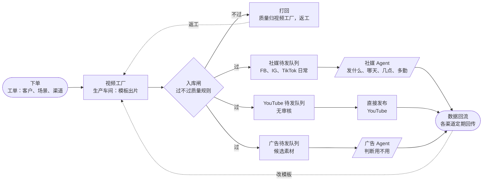

# 视频模板优化手册 v1.0（生产车间模型）

> 负责：ME Video（视频工厂） ｜ 范围：视频/图片模板的画面质量、入库闸、渠道分流、数据回流（不含素材本身质量，素材归素材库专项）
> 状态：**已核实（对照代码，2026-10-27 一次，有 3 处核不了，见 §6）**；2026-10-26 起 §3 钩子 / 片尾 / 字卡与 §5 P0 第 3、4 条按模板默认更新 ｜ 日期：2026-10-27 ｜ 最后核实：2026-10-26 ｜ 风险：C（仅文档）
> 依据：`scripts/factory-worker/remotion-branch.mjs` · `scripts/factory-worker/engines/remotion/render.mjs` · `scripts/factory-worker/engines/remotion/src/*Reel.tsx` · `src/lib/maliang/render-check.ts` · `src/lib/inngest/functions/{maliang-render-check,factory-creatomate-render,youtube-publish}.ts` · `src/lib/visual/openai-images.ts` · `src/lib/factory/worker-guard.ts`
> 格式：遵循 [视频工厂索引](./video-factory-index.md) 的「统一写法」。工单数为只读查库的数据快照，代码里核不了。

## 1. 结论

Remotion 是主力出片工具。成片交付后会走和 Creatomate 同一套马良画面自检。过关、没过、自检过程失败或超时，工单都留在人工审片队列。没过的卡片上写「马良没过」和原因，由人决定通过或打回。过程失败标成还没经过机器审。明信片的开场钩子、标题片尾和字卡安全区已有模板默认。主体检测和多比例成片还没有。

| 指标（数据快照 2026-10-27，近 30 天，未对库复核） | 数值 | 说明 |
|---|---|---|
| 视频工单 | 134 | |
| 走 Remotion | 133 | 另 1 条未记录引擎 |
| 走 Creatomate | 0 | 最后一单 2026-09-22 |

> 马良自动审画面：Creatomate 成片落库后由 `factory-creatomate-render.ts` 发 `me/maliang.render.ready`。模板出片（Remotion）在工单交付成功后发同一条事件（`enqueue-remotion-review.ts`），`maliang-render-check.ts` 两条都收。裁决都是 `maliang_check`：内容帖写在快照里，工单写在 `output` 里（工单没有内容帖，没有为这件事加字段）。模板出片无论过关、没过、抛错或超时，工单都留在 `in_review`。没过只在审片卡片上标「马良没过」和原因。抛错或超时标 `machine_reviewed: false`。Creatomate 没过仍标成需要返工，这条没改。

## 2. 流程（生产车间）

- 视频工厂只管把片子做好看、做合格；过闸的片子按渠道进待发队列。
- 社媒队列：社媒 Agent 决定发哪条、哪天、几点、多久发一次。
- YouTube 队列：目标是不再人工审核、直接发，所以入库闸要把好关。**注意：现有 YouTube 模块只做「已批准成片 → 私密上传 + 回读回执」，不是直接公开发布**（见 §6）。
- 广告队列：广告 Agent 判断用不用；花钱投放仍然要 Ray 点头。
- 打回的片子算视频工厂的质量问题，由工厂返工。
- 各渠道数据定期回流到视频工厂，用来改模板。

## 3. 入库规则（质量闸）

「现在」列已对照代码。

| 规则 | 怎么判 | 现在 | 说明与依据 |
|---|---|---|---|
| 有实际内容 | 屏幕上有连续 2 秒以上可见的地点、卖点或品牌卡 | 自动 | 内容闸，出片前拦；`engines/remotion/src/contentSubstance.ts`，结果写入成片体检证据（`remotion-branch.mjs` 约 920 行） |
| 屏幕文字干净 | 无隐形字符；文字交给服务器红线复扫 | 自动 | 出片机清洗隐形/双向/控制字符（`remotion-branch.mjs:118` 起）；每个模板都有文字复扫接线，未知模板拒绝出片（约 864–875 行） |
| 配乐合规 | 曲子已登记、无人声、覆盖实际使用的那段 | 自动 | `music-vocal-gate.mjs`；`remotion-branch.mjs:437` 起 |
| 成片体检 | 分辨率 1080×1920、时长误差 0.5 秒内、配了乐就必须有音轨 | 自动 | `remotion-branch.mjs:877–889`，上传前执行 |
| 素材完整 | 素材拷贝完整、不是云端占位文件、氛围片裁剪是 9:16 | 自动 | 氛围片预检在 `remotion-branch.mjs:292–308`；云端占位文件由 worker 处理（见台账 `2026-10-15-factory-worker-dropbox-dataless-assets`） |
| 体积在上限内 | 成片 48MB 以内（存储上限 50MB） | 自动 | 编码仍以 CRF 18 为目标，忙镜头按 `encode-cap.mjs` 封顶码率；上传前拒绝超过 48MB 的成片（`remotion-branch.mjs`）。来自已合并的 #3245，本分支没有改这套参数 |
| 马良画面审 | 自动看画面有无穿帮、变形、文字错位 | 自动 | Creatomate 与模板出片交付后都跑（见 §1）。模板出片没过仍留在人工队列，卡片标原因 |
| 字不压主体 | 字卡不挡人脸、动物、产品等主体 | 部分 | 仍没有主体检测。明信片字卡默认改到安全区上沿或下沿（偶数场景靠下、奇数场景靠上），旧的 `cardTop` 会先收到安全区里；`cardZone` 可指定上或下。字卡仍可能挡住主体，只是不再整片钉在画面正中 |
| 平台安全区 | 字和 CTA 避开各平台按钮区和标题区 | 部分 | 开场钩子和片尾落版画在安全区矩形内（9:16 沿用 top 270、bottom 1248、左右 60 与 960）。其它模板的正文位置未改。不是出片前自动闸 |
| 前 3 秒有钩子 | 首帧就有动作，3 秒内说清看点 | 部分 | 明信片默认前 2 秒（60 帧）用共享钩子：大字逐行滑入、数字弹出或问句，字宽约占画面 70%，关键词用品牌色，底下是一层淡遮罩而不是小字卡。缺文案时，工单里已有中文则用「先看这里」，否则用 `Watch this`。清单、快剪、数字卡、氛围片默认关，工单 `frame.hook` 才打开 |
| 片尾落版 | 居中 logo、名称、一个行动引导 | 部分 | 明信片标题结尾换成落版：字标或 logo、名称、一条至少占画面约 55% 宽的行动按钮、可选联系方式，都摆在安全区里。没有 logo 时用品牌色字标，不再用色块占位。缺行动引导时，工单里已有中文则用「了解更多」，否则用 `Learn more`。带价格的结尾默认仍是价格卡。其它模板要 `frame.endCard` 才开 |
| 比例对渠道 | Reels/TikTok/Shorts 9:16，FB 动态 4:5，兜底 1:1，YouTube 长片 16:9 | 没有 | 成片体检强制 1080×1920，视频只出 9:16 |
| 不该出现的价格、日期 | 按渠道和客户规定，禁的地方不出现价格或日期 | 部分（红线短语由客户配置，无通用价格/日期词表） | 见 §6 未核实项 3 的结论 |
| 人工审片 | 审核台看一遍再放行 | 人工 | YouTube 目标是不审，所以闸要更严 |

## 4. 现状与差距

| 环节 | 现在 | 目标 |
|---|---|---|
| 出片之后 | 在审核台人工点通过，系统把视频传到客户 FB 主页存成不公开草稿 | 过入库闸后自动按渠道进待发队列 |
| 社媒 | 有 Reel 发布/评论/度量代码（`src/lib/social/reel-publishing.ts`、`post-measurement-store.ts`、`factory.reel.published` 事件）；没有找到「社媒 Agent 按节奏排期并从工厂选片」的接线 | 社媒 Agent 决定发什么、何时、多勤 |
| YouTube | 已接工厂：`youtube.staging.requested` → 只接受工厂存储里的已批准成片，私密上传并回读（`youtube-publish.ts`） | 无审核，直接发 |
| 广告 | 要手动加进素材池并设推广窗口；#3239 在做「通过的片子变成暂停的广告草稿」 | 广告 Agent 判断用不用，投放花钱仍需 Ray 批 |
| 打回 | 审核台退回，原因没有统一分类 | 每次打回归到一条入库规则，下周改模板 |
| 数据回流 | 只有工厂内部数据（过审率、死信率）；社媒侧已有 Reel 度量同步但未回到模板 | 各渠道定期回流，驱动模板修改 |

### 打回怎么处理

> 归属：打回的片子是视频工厂的质量问题，不是素材库、社媒或广告的问题。

1. **记原因**：字压主体、开场无力、片尾缺失、比例不对、配乐、太大、穿帮等，选一个。
2. **对到规则**：对到 §3 一条入库规则；对不上就新增一条。
3. **能自动就自动**：人工发现两次以上的问题，排进改进清单做成自动闸。
4. **改模板**：每周三模板优化时改，下一批片子验证。

### 数据回流

| 渠道 | 看什么 | 多久回一次 | 谁交数据 | 改模板哪里 |
|---|---|---|---|---|
| 广告（Meta、TikTok） | 3 秒观看率、看完率、点击率、单次结果成本、广告 Agent 不用的原因 | 每周 | 广告 Agent | 钩子、时长、CTA、比例 |
| FB、IG 日常 | 3 秒观看、平均观看时长、完播、转发和收藏、评论 | 每周 | 社媒 Agent | 开场、字幕、节奏、片尾 |
| TikTok 日常 | 前几秒留存、完播、关注、评论 | 每周 | 社媒 Agent | 钩子类型、节奏、音乐 |
| YouTube Shorts | 看下去还是划走、平均观看、留存曲线 | 每周 | YouTube 发布方 | 开场承诺、循环结尾 |
| YouTube 长视频 | 缩略图点击率、留存曲线、章节跳出点 | 每月 | YouTube 发布方 | 缩略图、章节、片尾推荐 |
| 视频工厂自己 | 过闸率、打回原因、死信率、审片通过率 | 每天巡检 | 视频工厂 | 入库规则、模板默认值 |

数据怎么变成改动：3 秒观看低 → 换钩子类型；完播低 → 缩短或加快换镜；点击低 → 改片尾和 CTA 位置；Agent 常不选某类片 → 查那类模板；同一打回原因反复出现 → 做成自动闸。

基线：现在没有各渠道的真实基线，不预设数字。回流上线后先攒两周真实数据，再定各渠道及格线。

### 场景覆盖

| 场景 | 进哪个队列 | 比例 | 时长 | 前 3 秒 | 声音和字幕 | 结尾 | 模板 |
|---|---|---|---|---|---|---|---|
| 广告·Reels/Stories | 广告 | 9:16 | 6–15 秒 | 品牌和核心信息，首帧有动作 | 必须字幕，多数静音看 | 一个行动，放安全区 | postcard、list（去价格） |
| 广告·FB 动态 | 广告 | 4:5，1:1 兜底 | 6–15 秒 | 首帧最强画面，不淡入 | 静音也能看懂 | 片尾卡加按钮 | 缺 4:5 导出 |
| 广告·TikTok | 广告 | 9:16 | 先测 15–30 秒 | 3 秒讲卖点 | 必须有声，商用曲库 | 口播式 | 缺口播风格 |
| 日常动态·FB/IG | 社媒 | 9:16 | 讲完就停 | 让陌生人 3 秒看懂 | 建议字幕，加音频 | 引导转发 | postcard、montage |
| 日常动态·TikTok | 社媒 | 9:16 | 15–60 秒 | 从最精彩瞬间开始 | 流行音频，原生感 | 引导评论关注 | 缺原生感模板 |
| YouTube Shorts | YouTube | 9:16 | 3 分钟内，超 1 分钟慎用有版权的曲 | 1–3 秒给承诺 | 首句字幕等于首句口播 | 循环结尾 | postcard、montage |
| YouTube 长视频 | YouTube | 16:9 | 按内容，分 3 段以上章节 | 缩略图加标题 | 字幕文件，旁白 | 章节和片尾推荐 | 没有 |
| 宣传推广（品牌片） | 广告或社媒 | 16:9 和 9:16，再切 4:5 | 主片 30–90 秒，切 15 秒和 6 秒版 | 品牌和最强画面 | 旁白叙事加配乐，必须字幕 | 品牌记忆加官网或关注 | 没有，要新建品牌故事模板 |
| 产品介绍 | 广告或社媒 | 9:16 和 4:5，官网 16:9 | 15–45 秒 | 先给痛点或结果 | 旁白讲解，卖点字卡 | 一个行动：了解、试用或填表 | 没有，要新建产品讲解模板 |

平台规格来自 Meta、TikTok、YouTube 官方说明；TikTok 15–30 秒是行业经验，不是官方要求。

### 行业公式（候选参考，未经 ME 数据验证）

| 行业 | 推荐模板 | 前 3 秒 | 中段和结尾 | 日常 |
|---|---|---|---|---|
| 旅游 | postcard、montage | 最美一景加反问句 | 地点标签加一句卖点；不写日期价格时引导填表 | 一处一个冷知识 |
| 餐饮 | postcard 菜品版、快剪 | 热气、拉丝、切开特写 | 菜名加一个理由，要有现场声 | 后厨、出餐过程 |
| 零售电商 | list（去价格）、产品讲解（待建） | 痛点或前后对比 | 3 个卖点各 1–2 秒，产品全景，一个行动 | 开箱、口播 |
| 教育 | datacard 加口播字幕 | 反直觉数字或问题 | 逐词字幕讲一个点 | 长视频带章节 |
| 房地产 | postcard 房源版 | 最好的空间或景观 | 区域和户型标签不压主体 | 4:5 和 9:16 同出 |
| 本地服务、B2B | datacard 加真人、品牌故事（待建） | 客户问题或成果数字 | 过程、结果、联系方式 | 1:1 或 4:5 案例 |

### 现有模板问题

近 30 天单数为数据快照 2026-10-27，未对库复核。

| 模板 | 用途 | 近 30 天 | 主要问题 | 状态 |
|---|---|---|---|---|
| postcard | 2–4 个场景轮播 | 52 单 | 字卡不再整片钉在 `cardTop` 800；开场默认共享钩子（首镜推近 1.12）；标题结尾用居中落版。仍无主体检测，价格结尾默认不换落版。左上角 logo 在钩子和落版期间让开 | 主力 |
| list | 卖点清单 | 71 单 | 含价格画面（`ListReel.tsx` 使用 `PriceScene`），和不写价格的要求冲突；「被替代 49 次」来自库，未核 | 在用 |
| montage | 节拍快剪 | 6 单 | 需要 8 个以上镜头、3 类以上，素材门槛高（门槛数字未逐行核，见 `MontageReel.tsx` / `montage.ts`） | 少用 |
| datacard | 数字说服 | 1 单 | 纯色底，没有实拍 | 试过 |
| atmosphere | 单镜头氛围 | 3 单 | 审片判没有实际内容，降为素材（来自库） | 降级 |
| impact（#3111） | 强节奏 | 0 单 | 主分支 Remotion 模板里没有 impact；内容闸会不会全拦未核 | 返工（未合并） |
| Creatomate | 图生视频 | 0 单 | 单段超过 3–4 秒容易穿帮（经验结论） | 闲置 |
| 图片工厂 | 出图 | — | 已核实：`src/lib/visual/openai-images.ts:10` 把 `4:5` 映射到 `1024x1024` | 在用 |
| 渲染设置 | — | — | `render.mjs` 仍是 h264、crf 18，另加码率封顶（`encode-cap.mjs`）。上传前 48MB 拦截在 `remotion-branch.mjs`。几条片 28–47MB、一条超 50MB 为库内旧记录 | 已接（#3245） |

postcard 的死信多是缺素材、配乐登记、文件太大，不是画面问题；素材问题归素材库专项。

## 5. 改进清单

### P0 先做
1. 马良自动审画面已接到模板出片：交付后自动审。过关、没过、自检过程失败或超时都留在人工队列。没过的卡片写「马良没过」和原因，人决定通过或打回。字压主体等其余画面规则仍未做。
2. 码率封顶和上传前 48MB 拦截已在主干（#3245）。本分支没有改编码参数。
3. postcard 字卡位置：安全区上沿 / 下沿交替和夹紧已做。出片前检查是否压主体还没有（没有主体检测）。
4. 开场和片尾：明信片已接共享钩子（逐行弹入、数字或问句）和标题结尾落版。清单、快剪、数字卡、氛围片默认关，避免和现有每日成片叠两层字。全模板默认开、以及价格结尾也落版，还没做。
5. 一张工单同时出 9:16、4:5、1:1，并按平台自动避开按钮区；修好图片工厂的 4:5。

### P1 接着做
- 打回原因分类，并把入库闸结果写进每张工单，方便回流分析
- 钩子库：按行业和场景挑开场方式
- 字幕样式：逐词高亮、短句底条
- 旁白轨：品牌片和产品讲解的前提
- 曲库按时长和情绪选曲（曲库数字来自库，未核）
- 分平台片尾；impact 模板（#3111）返工
- 价格/日期禁用口径：先定「谁来配置」（客户配置 or 渠道策略），再谈自动闸

### P2 新模板和进阶
- 新建品牌故事模板：旁白加逐句字幕，开场、故事、证据、品牌落版，自动切 15 秒和 6 秒版
- 新建产品讲解模板：箭头、圈出、局部放大跟着产品走，痛点、3 个卖点、演示、一个行动
- 一单多钩子做对比测试；16:9 长视频加缩略图
- 原生感模板（口播、开箱风格）；AI 生成标识位

目标的快速出片流程：选行业、场景和渠道，自动带出模板、比例、时长、钩子、曲目、安全区和 CTA；填一句钩子，从素材库选素材；一次出全部比例，自动过入库闸，再进对应的待发队列。

## 6. 依据与未核实项

### 三处原「未核实」项的结论（2026-10-27）

1. **社媒 Agent 排期有没有接到工厂：没有找到。** 有 Reel 发布与度量代码（`src/lib/social/reel-publishing.ts`、`post-measurement-store.ts`、事件 `factory.reel.published`），但没有「社媒 Agent 从工厂选片并排期」的接线。结论：未接，视为差距。
2. **YouTube 发布模块有没有接工厂：已接，但只到私密暂存。** `src/lib/inngest/functions/youtube-publish.ts`：事件 `youtube.staging.requested`，只接受工厂存储里的已批准成片，私密上传并回读回执；入口 `src/app/api/clients/[id]/youtube/stage/route.ts`。「无审核直接发」是目标，不是现状，也未获发布授权。
3. **红线复扫的价格、日期词表：没有通用词表。** `src/lib/factory/worker-guard.ts:104`（`scanRedlineHits`）只对「客户配置的红线短语 + 排除话题」做大小写不敏感的子串匹配；命中不自动打回，只写 `redline_hits` 让审核卡标红。所以价格、日期是否被拦取决于每个客户配的短语。

### 仍核不了

- 全部工单数、各模板单数、「被替代 49 次」、产物大小实测、曲库数字：来自只读查库，标为数据快照 2026-10-27，未复核。
- #3245 已合进主干。#3239、#3111 的合并状态本次未逐一查看，以 PR 页面为准。
- montage 的「8 个镜头、3 类」门槛、前 3 秒/静帧的观感判断：未逐行核代码或逐片目测。

### 对原稿的更正

- 「左上角一直挂 logo」：默认只在最后 60 帧出现，仅 `logoMode=always` 才从头挂；位置在左上区域（left 54 / top 292）。2026-10-26 起，钩子和落版播放时这段 logo 让开。
- 2026-10-26：明信片开场和标题片尾已接共享组件；字卡改到安全区上沿或下沿。「没有钩子 / 没有落版 / 字卡钉在 800」不再是现状。主体检测和多比例成片仍没有。
- 「YouTube 发布模块是否接工厂未核实」：已接（私密暂存）。
- 「价格、日期」那条：不是未核实，而是无通用词表、靠客户配置。
