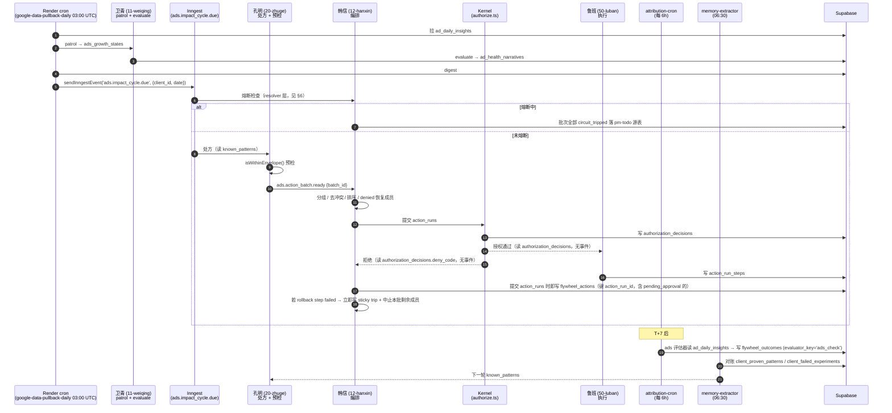

# 广告 WP3 · Impact loop 接线 设计稿 v2.2

状态：**accepted**，PM 2026-09-27 经小秘书窗口（`local_2bc4fba6-9a3f-426e-ac87-11458f9591d3`）口头认。原话「按新版重做」，同时等于对本设计稿的正式认可。作为本轮 3.1b 重做（分支 `feat/ads-wp3-1b-v2`）的权威实施依据；上一轮 PR #2087（分支 `feat/ads-wp3-1b-circuit-breaker`）照总纲 spec §3 G11 实施，跟本文件不一致，作废。
v2.2 · 2026-09-27 · **PM 在统筹窗口（`local_0a9daab4-9fc9-4838-9781-45641d2c4bcf`）亲口决定「三个一起」** —— 三条绕过 Kernel 的旁路（`meta-ads/execute`、`meta-ads/boost-post`、`winner-reel-sync`）**本轮（3.1b）一起收编进 Kernel，不留到下一轮**。据此放宽两处：**§0 的「本 WP 不新增 capability、不新增 ActionKey」** 与 **§12 分批表 3.1b 那行的旁路范围**（原先只点名止损一条）。放宽后本轮新增 4 个 ActionKey（系列级暂停 / 系列级砍预算 / 推帖 / 建广告），层级门由统筹窗口以 Inline 模式过：**全部挂在既有广告 L1 支柱下，不新增能力线 / 支柱 / capability 域，不进 `platform-candidates`**。每个新 ActionKey 的**撤回处理函数必填**（K1，少一个 `authorize.ts` 直接拒）。🔴 **`winner-reel-sync` 的保护判据是「学习期」不是「预算」**，见 §12 那行的补注。
v2.1 · 2026-09-25 · 第二轮三方复审 21 条（子牙 4 / 魏征 6 / 狄仁杰 4 + 建议）全部并入；复核：狄仁杰判 3.1a / 3.1b 均可进（§6.9 三条实施必带已入）；子牙闭合确认后剩 2 条必改 + 1 处矛盾 + R15/R20 一句话改法已由统筹窗口直接落稿（§7.2 `action_run_id` 列已存在改加部分唯一索引、韩信提交时即写 `flywheel_actions`、§5.3.2 过滤按 `deny_code` + 前缀）。
v2 · 2026-09-25 · 三方设计复审后按章重写（子牙 6 / 魏征 19 / 狄仁杰 8）。
Repository Fact Gate：`origin/main` = `6516c1eb` · fetched 2026-09-25。
前置总纲：[`docs/specs/2026-09-24-agent-autonomy-operating-plan-v1.md`](./2026-09-24-agent-autonomy-operating-plan-v1.md)（PR #1985 已合并）。
前置支柱 spec：[`docs/specs/2026-09-24-ads-goal-driven-autonomous-impact-loop-v1.md`](./2026-09-24-ads-goal-driven-autonomous-impact-loop-v1.md)（PR #1956 已合并 `33e9df18`；WP0 = PR #1960、WP1 = PR #1962 已合并，WP2 = PR #1979 已合并 `a6ddc6d5`，恢复白名单 migration 已 apply）。
本 WP 是总纲 §5 表里的 **B1 广告 WP3**，风险级 **A**，执行 = ME 广告构建控制（DeepSeek 执行），复审 = 子牙 + 魏征（设计前后各一次），狄仁杰看同步开关。

---

## 0. Tier Classification

本 WP 同时改 **Kernel 域**（`client_automation_policies` / `authorization_decisions` / `action_runs` 的读写路径、`autonomy-envelope.ts` 的调用点）与 **Ads 域**（`ad_strategy_configs` / `ads_growth_states` / `ad_daily_insights` / `flywheel_outcomes` 的读写路径），并新增一条跨域事件链（Inngest）。

按 [ME2 Reuse & Platformization Principle](../roadmap/2026-08-19-me2-platformization-principle.md) 的五道 Build Gate，本 WP 落在 **Gate #4「跨域接线」**：

- **不是**简单的支柱内改动。支柱内改动（例如给卫青加一条诊断判据）只碰 `src/lib/ads-strategy/`，不碰 Kernel 的授权路径，也不新增事件链。
- **不是**新增能力线。~~本 WP 不新增 capability、不新增 ActionKey~~ （🔴 **已由 v2.2 放宽，见顶部版本行**：PM 2026-09-27 决定三条旁路本轮一起收编，因此本轮新增 4 个 ActionKey；但仍**不新增能力线、不新增支柱、不新增 capability 域** —— 4 个全挂在既有广告 L1 下，方向是把执行手**收进**闸门，不是把执行手包装成智能层）；不新增智能层；它把**已经存在的**零件（Kernel 信封、`isWithinEnvelope`、`ad_entity_snapshots`、`ad_daily_insights`、`flywheel_outcomes`、pm-todo 三件套、Inngest 编排范式）按 agent 挂上闹钟与署名。
- **是**跨域接线：Kernel 的授权判据（信封）第一次被 Ads 域的**预检**复用；Ads 域的**熔断**第一次成为 Kernel 授权路径的上游闸；Ads 域的**学习回流**（`flywheel_outcomes` → `client_proven_patterns` / `client_failed_experiments`）第一次闭环。

因此本 WP 的 tier-gate 判定：**platform-shared 机制复用，无新增 platform-shared 机制，无 industry-specific 内容，client-specific 只落在各客户的 `ad_strategy_configs` 行**。

---

## 1. 一句话结论

WP3 把广告支柱从「卫青出诊断 → 诸葛亮转处方 → 鲁班执行」这条**人工接力**，接成一条**有闹钟、有闸门、有回执、有学习**的闭环：`ads.impact_cycle.due` 每天自己醒 → 孔明出批量处方 → 韩信编排去冲突 → Kernel 按信封授权 → 鲁班执行 → T+7 Check 回读 → 学习回流 → 下一轮孔明读学习表。**新增一个 agent（韩信，编号 12）承担编排，其余全是已有零件的接线。**

### 1.1 总原则（接线不另建）

- **接线不另建**：Kernel 一行不动（`deps.ts:58-62`「Kernel 刻意不认识广告表」）；Check/Tune 复用已在跑的 `flywheel_actions → attribution/job.ts → memory/extractor.ts`；每日链条挂在现有 `google-data-pullback-daily` 末尾，不开第二个 cron。
- **Inngest 函数只做接线**：放 `src/lib/inngest/functions/ads-*.ts`；判据全在新目录 `src/lib/ads-strategy/autonomy/`。
- **pm-todo 是拉模式**（`manual-items.ts:69+` 读时拼装）：凡「写 pm-todo」必须指定源表 + 一个 `push*Items` 拉取函数（见 §K）。
- **事件命名** `<域>.<对象>.<动词>`：`ads.impact_cycle.due` / `ads.autonomy_mode.changed` / `ads.action_batch.ready` / `ads.circuit.tripped` / `ads.circuit.released`。id = `${client_id}:${date}:${stage}`，其中 `date` 按**客户时区**（`resolveClientEvaluationDate`）取，不是 UTC 日期。
- **Kernel 不发 Inngest 事件**：v1 稿里「授权 / 拒绝 / 已执行」三个 `ads.action.*` 事件名**不存在**（Kernel 的 gateway / capability / `kernel/*.ts` 都不 `sendInngestEvent`）。Kernel 的授权与执行回执只落在 `authorization_decisions` / `action_runs` / `action_run_steps` 三张表里，由韩信与日报**读表**，不靠事件。

---

## 2. §1 系统架构：每日链条

### 2.1 全景时序图



### 2.2 逐段说明

| # | 触发事件名 | 谁写 | 谁读 | 回执（写到哪张表 / 什么字段） | fail-closed 边界 |
|---|---|---|---|---|---|
| 1 | `ads.impact_cycle.due` | Render cron `google-data-pullback-daily` 末尾（每客户**每天，7 天都发**；只有 PM 日报的发送跳周五 / 周六，见 §6.6） | 韩信（step 1 = 熔断评估器：#1/#2/#4 的 trip 在这里写） | `ads_action_batches` 行 | 采数失败 → 不推事件，当日整条链停 |
| 2 | `ads.action_batch.ready` | 孔明（处方 + `isWithinEnvelope` 预检完成后发，与 §2.1 时序 KM→HX 一致） | 韩信（编排 → Kernel 提交） | `ads_action_batches` + `ads_action_batch_items` | 熔断中 → 批次全部 `circuit_tripped` 落 pm-todo 源表，不入 Kernel |
| 3 | （无事件）Kernel 授权回执 | Kernel | 韩信 / 日报 | `authorization_decisions.verdict` / `deny_code` | deny 且 `deny_code = 'outside_autonomy_envelope'` → 不执行，写 pm-todo，等下一轮恢复（见 §5）；pre_provider 层拒绝 → `dead_letter + needs_human`，走 handoff 待办，**不进韩信恢复**（见 §6.1） |
| 4 | （无事件）Kernel 执行回执 | 鲁班 | 韩信 / attribution-cron | `action_run_steps.output` + `flywheel_actions.action_run_id` | 执行失败 → Kernel 只写 `dead_letter`（不写 `status = 'failed'`）；`flywheel_actions` 在韩信提交时已写，`ads_check` 以 `action_runs.status='succeeded'` 的 step 完成时间为 T0，未成功的不评估 |
| 5 | `ads.circuit.tripped` / `ads.circuit.released` | 熔断判据 / admin | 韩信 / resolver | `ads_circuit_events` 行 | 读不到 / 解析失败 = 视为熔断中（见 §6） |

### 2.3 事件命名约定

沿用 CLAUDE.md 铁律 §3 的 Inngest 硬约束：事件名业务可读、每个关键阶段有机器可读 receipt、人工审核只能推进到下一事件、副作用 fail-closed。本 WP 的事件名统一前缀 `ads.`，与已有的 `flywheel-seo-weekly` / `ai-visibility-weekly` / `competitor-watch-weekly` 周任务并列。

### 2.4 保留的既有 cron（不新开、不双写）

| cron | 频率 | 职责 |
|---|---|---|
| `google-data-pullback-daily` | 03:00 UTC | 拉 `ad_daily_insights` → 卫青 patrol → `ads_growth_states` → evaluate 写 `ad_health_narratives` → digest；**末尾** `sendInngestEvent('ads.impact_cycle.due', {client_id, date})` |
| `ad-entity-snapshot` | 每 3h | 写 `ad_entity_snapshots` |
| `execution-auto-run` | 09:30 | 看板一键 / 自动执行入口 |
| `attribution-cron` | 每 6h | `attribution/job.ts` 算 baseline/after 写 `flywheel_outcomes` |
| `memory-extractor` | 06:30 | `memory/extractor.ts` 对账两张学习表 |

**Inngest 链不采数、不跑张骞 / 华佗**（原稿 §2.1 把它们画进广告链是错的）。Inngest 链只做：熔断检查 → 孔明处方（+`isWithinEnvelope` 预检）→ 韩信编排（含 denied 恢复成员）→ Kernel 提交 → 日报补两段。**不新开 cron、不双写 `ads_growth_states`。**

### 2.5 库侧「该日已跑」闸

`ads_action_batches UNIQUE (client_id, ad_account_id, date)`（Inngest 去重窗只 24h，不够）。每账户每层一个 step（125s 网关，PITFALLS F8）。

🔴 **撞 UNIQUE 不是失败，是「今天已经跑过」**：`INSERT … ON CONFLICT DO NOTHING RETURNING id`；无返回 → `SELECT` 既有批次继续往下走，receipt 记 `already_ran`。**不停、不死信、不重复建批次。** 成员按 `(batch_id, adset_id, action_key)` 幂等。

`date = resolveClientEvaluationDate(...)`（**客户时区**，不是 UTC）。

🔴 **事件发送失败不能拖垮采数**：pullback 在每客户循环里 try/catch `sendInngestEvent`（`inngest-event.ts:19/34` 会 throw），结果记进 result JSON + `cron_runs`。人工补跑同一天 → 同 event id 被 Inngest 24h 去重，receipt 里可见。

### 2.6 活性感知

`pushAdsCycleLivenessItems`：昨天（按 **Pacific/Auckland**，**每天都查**——链条 7 天跑，只有日报发送跳周五 / 周六）有 `enabled` 客户但**没有** `ads_action_batches` 行 → 写待办（对照 `pushCronHealthItems` 的范式）。**空处方日也建批次行（0 成员）**，否则「没跑」和「跑了但没处方」分不开。

### 2.7 证据

- `src/lib/kernel/deps.ts:58-62`（Kernel 刻意不认识广告表）
- `src/lib/pm-todo/manual-items.ts:69+`（pm-todo 拉模式）
- `render.yaml:650`（`memory-extractor` 06:30）
- `src/lib/workflows/inngest-event.ts:19/34`（`sendInngestEvent` 会 throw）
- `src/lib/pm-todo/manual-monitoring-items.ts:210`（`pushCronHealthItems` 范式）

---

## 3. §2 韩信新 agent 论证

### 3.1 结论

**选 (a)：新建 `docs/agents/12-hanxin.md`，编号 12。**

### 3.2 编号语义位置

`docs/agents/` 现有编号：`10-ziya`（架构）· `11-weiqing`（广告支柱）· `20-zhuge`（诸葛亮 = 孔明，业务大脑 / 处方）· `30-zhangqian`（发现）· `40-huatuo`（诊断）· `50-luban`（执行）· `60-maliang`（内容）· `70-libai`（文案）· `80-davinci`（视觉）· `90-weicheng`（合规 / 攻击验证）。

**11 之后直接跳到 20，中间没有空位。** 取 `12-hanxin.md` 的语义是：**紧跟卫青、同属广告支柱执行侧**（卫青定标准 → 韩信排战役 → 孔明出战略）。这个位置在文档目录里一眼可见，不需要额外解释。

### 3.3 为什么不是塞进现有 agent

| 候选 | 为什么不选 |
|---|---|
| 塞进孔明 (20-zhuge) | 孔明判断「该做什么」（单条处方级，战略）；韩信合并「批量怎么做」（跨处方去冲突 / 排队 / 预算过闸，战术）。两者混在一起会让孔明的 prompt 同时承担战略与战术，且孔明是业务大脑，不该知道「同一 adset 一天只 1 次改动」这种执行细节 |
| 塞进鲁班 (50-luban) | 鲁班推每一个具体动作到外部平台（执行）；韩信在鲁班**之前**决定「哪些动作、什么顺序、能不能一起做」。鲁班不该有编排权——它收到任务就执行，不重新评估优先级（见 `docs/agents/50-luban.md` §一） |
| 塞进卫青 (11-weiqing) | 卫青是数字营销执行监督总管，管**标准**（诊断判据、处方类型、健康档）；韩信管**战役**（这一批怎么打）。卫青的职责边界里明确「不直接改 Meta 广告后台」，编排也不该塞进去 |

### 3.4 韩信职责（4 点）

1. **分组**：按 `(client_id, ad_account_id)` 分组。同一账户的动作一起编排，跨账户不混（跨账户挪钱是 PM 授权项，见 `docs/agents/11-weiqing.md` §四）。
2. **去冲突**：同一 `adset_id` 一天只允许 1 次改动。多条处方指向同一 adset → 按优先级保留 1 条，其余写 pm-todo 说明「**72 小时后再评估**」（不是「排到明天」——信封冷却期是 72h）。
3. **按优先级排队**：**收类先、加类后**。`pause` / `cut_unit_budget` 先执行（先止血），`scale_unit_budget` / `add_retargeting_adset` 后执行（后扩张）。同一优先级内按 `expected_impact` 降序。
4. **钱闸只有一道：信封的 `daily_budget_cap_cents`**（`isWithinEnvelope` 的三档判据，见 §5.1）。**韩信不做任何金额加总。**

   🔴 为什么删掉原来的「按 `spend_cap_per_run_usd` 加总估算花费」：Kernel 拿 `spend_cap_per_run_usd` 比的是 `costModel.estimate` —— **这次执行本身的 API 花费**（`authorize.ts:443-469`），不是广告预算。六个 ads 动作的 `estimate: () => 0`（registry-ads.ts），所以任何加总恒为 0，那道闸从来没生效过。一列两义，广告侧不能拿它当钱闸。

   `spend_cap_per_period_usd` 任何地方不读（RESERVED · NOT ENFORCED，migration 20260808 :39-44）。

### 3.5 韩信与卫青的关系

卫青是**数字营销执行监督总管**（`docs/agents/11-weiqing.md` §一：「你的受众是诸葛亮（业务大脑）和 PM」）。韩信作为**战役编排**放在卫青下面一号位很自然：卫青定「什么算健康、什么算该动手」，韩信定「这一批动手怎么排」。卫青的 KPI 是「每客户每条广告每结果成本可持续」，韩信的 KPI 是「卫青开的处方，在不违反信封和熔断的前提下，尽可能多地真正落地」。

### 3.6 证据

- `docs/agents/11-weiqing.md` §一 / §四 / §六
- `docs/agents/50-luban.md` §一
- `supabase/migrations/20260808000003_me2_execution_kernel_v1.sql:39-44`（`spend_cap_per_period_usd` RESERVED · NOT ENFORCED）

---

### 3.9 日预算上限按账户存（PM 2026-09-25 提出：CTS 主账户 100 / 个人账户 50，客户级一行装不下）

实测：`ad_strategy_configs.daily_budget_cap_cents` 按客户一行；`client_meta_ad_accounts(id, client_id, ad_account_id, label, is_primary, …)` 已是「客户 ↔ 广告账户」绑定表，唯一键 `(client_id, ad_account_id)`，CTS 两行、其余客户各一行。信封事实 `accountDailyTotalBeforeCents` 本来就按**账户**算（`envelope-facts.ts`，CBO/ABO 分别加总），拿它去比客户级上限 = 每个账户都能到上限、合计 2×（狄仁杰 R2 专攻 6 同一个坑）。

**拍板（技术，本窗口）：不新建表，上限落到绑定表上；客户级那一行变成总闸。**
- `client_meta_ad_accounts` 加 `daily_budget_cap_cents integer NULL`（3.1b migration，`ADD COLUMN IF NOT EXISTS`）。
- `ad_strategy_configs.daily_budget_cap_cents` = **全部账户合计不许超**的总闸：熔断 #2 比它；PATCH 校验 `sum(账户上限) ≤ 客户总闸`，否则 400。
- 信封事实（3.1b `envelope-facts.ts`）：`dailyCapCents` = 该实体所属账户的上限；账户上限 NULL 时——客户只绑 1 个账户 → 用客户总闸；绑 ≥2 个 → `unavailable('facts: 账户级日上限未配置')` → 拒（读不到 = 不动）。
- Settings UI：账户绑定面板上可填每个账户的上限（走同一条 `guardGlobalAdmin` PATCH），铁律 8「要填的字段必须连 UI 一起做」。
- CTS 现状：客户级已存 150（总闸），账户级 100 / 50 等 3.1b 上线后在面板填；在那之前任何自动动作本来就不会发生（resolver 未挂载）。

## 4. §3 autonomy_mode ↔ client_automation_policies.mode 同步

### 4.1 两个源的角色

| 源 | 表 / 列 | 谁写 | 谁读 | 角色 |
|---|---|---|---|---|
| **权威源** | `client_automation_policies.mode` | 只有 sync worker | Kernel（`authorize.ts` 的 `getActivePolicy`） | Kernel 认的**唯一**判据 |
| **意向源** | `ad_strategy_configs.autonomy_mode` | 内部全局管理员在 Settings 面板 | sync worker | 表达的**意向** |

### 4.2 写入口：不建新路由

**唯一写路径 = 现有 `src/app/api/clients/[id]/ad-strategy-config/route.ts` PATCH**（`requirePaidClientAccess` + `guardGlobalAdmin`，:38-47）。全文「客户面板」→「内部全局管理员在 Settings 面板」。

架构测试：写 `ad_strategy_configs.autonomy_mode` 的路由文件必须命中 `guardGlobalAdmin`。

### 4.3 同步方向：单向 意向 → 权威

**只允许** `ad_strategy_configs.autonomy_mode` → `client_automation_policies.mode`。反向不允许：Kernel 的授权决策是 append-only 的审计记录，不能被面板写入覆盖。

### 4.4 事件 = 叫醒铃

payload 只带 `client_id`；worker 一律 SELECT 库里当前值。Inngest `concurrency: { limit: 1, key: 'event.data.client_id' }`；事件 id `autonomy_sync:${client_id}:${updated_at}`。

**另加每日 reconcile**（不只靠事件）：每天 pullback 之后对账一次全部客户。

### 4.5 粒度：按 `(client_id, action_key)` 一行

migration 20260808 :28-32、:82-84 部分唯一索引 `WHERE effective_to IS NULL`。worker 从 capability registry **动态取** `ads.*` 全部 key 逐键写；只动 `mode` + `updated_by`；不碰 `spend_cap_*` / `decision_ttl_seconds`；`spend_cap_per_period_usd` 任何地方不读（RESERVED · NOT ENFORCED :39-44）。

缺行 INSERT 走 SQL 函数：`spend_cap_per_run_usd = 1.00`（**固定小常数**，只为绕开 `NULL = 不许花钱` :37；不按 cap 比例折算 —— 见 §3.4 第 4 点，这一列在广告侧不是钱闸），`decision_ttl_seconds` 表默认。

🔴 **副作用必须写明**：改 mode 触发 `policy_version +1`（:119-127）→ 在途授权全部 `policy_changed_since_request`，即「翻开关当天在途动作作废，下一轮重提」，日报要提示。

### 4.6 写法：条件单条 UPDATE，禁 upsert

部分唯一索引撞 `onConflict`，所以禁 upsert：

```sql
UPDATE client_automation_policies
   SET mode = $m, updated_by = $who
 WHERE client_id = $c
   AND action_key = $k
   AND effective_to IS NULL
   AND mode <> 'deny';
```

`mode <> 'deny'` 是**防御性守卫**：`deny` 为未来管理员 / 熔断预留，本 WP **没有写入者**，相关路径不实现不测试（见 §4.7）。affected = 0 且行存在 → 说明当前是 `deny`，worker 跳过不覆盖（v1 不会走到这条路径）。

### 4.7 映射表

| `ad_strategy_configs.autonomy_mode` | `client_automation_policies.mode` |
|---|---|
| `observe` | `require_approval` |
| `bounded_auto` | `auto_approve` |

实测 2026-09-25：`ad_strategy_configs.autonomy_mode` 的 CHECK 约束是 **`observe | bounded_auto` 两档**，没有 `manual`；目前 4 个客户全是 `observe`。`client_automation_policies.mode` 的 CHECK 约束是 **`auto_approve | require_approval | deny` 三档**，生产里观察到 `auto_approve` 和 `require_approval`。

🔴 **`deny` 永远不由同步 worker 写入，v1 也没有任何写入者。** 它是为未来管理员 / 熔断预留的值，不是 `autonomy_mode` 的映射目标。**v1 管理员的「关」= 把 `autonomy_mode` 设成 `observe`**（映射到 `require_approval`），不是写 `deny`。worker 遇到策略表当前是 `deny` 时**跳过不覆盖**（防御性 SQL 守卫，见 §4.6），v1 不会走到这条路径。

### 4.8 漂移检测：不在 Kernel

**漂移时不存在「退到动作声明档」的兜底写法**（策略值域是 `auto_approve | require_approval | deny`；动作声明档 `types.ts:168` 是另一层，不能拿来当策略值）。两处检测：

1. **worker 每日 reconcile**：对账全部客户。
2. **韩信提交批次前**：比 sync receipt 版本 vs `ad_strategy_configs.updated_at`，不一致 → 整批 `held_sync_drift`，`step.sleep(60s)` 重查 ≤3 次，仍不一致才一条**批次级** pm-todo（源表见 §K）。

原则：**不一致以更保守为准。**

架构测试只断言 `authorize.ts` **不** import 广告表；不存在「Kernel 读 `autonomy_mode`」的测试。

### 4.9 审计

- `ad_strategy_configs` 加 `autonomy_mode_updated_by text`（PATCH 从 `requireGlobalAdminUser` 取 email）。
- worker `updated_by = 'autonomy-sync:<email>:<source_updated_at>'`。
- 新表 `ads_autonomy_sync_receipts(client_id, action_key, source_updated_at, from_mode, to_mode, skipped_reason, synced_at)`，RLS `TO service_role`。

### 4.10 幂等键

`(client_id, autonomy_mode, ad_strategy_configs.updated_at)`。同一个 `updated_at` 的重复事件不重复写策略表。`updated_at` 变了 = 真的改了意向 = 应该重新同步。

### 4.11 架构测试伪代码（Vitest 风格，只写意图和断言）

```text
// 测试意图：API 层不许直接写 client_automation_policies
describe('API layer must not write client_automation_policies', () => {
  it('src/app/api/** 里没有 client_automation_policies 的 UPDATE / INSERT / UPSERT', () => {
    // 扫描 src/app/api/**/*.ts
    // 断言：命中数 === 0
  })
})

// 测试意图：sync worker 是唯一写入者（范围收窄到 ads.* 键）
describe('sync worker is the only writer of ads.* policies', () => {
  it('写 ads.* 键的 client_automation_policies 操作只出现在 sync worker 文件里', () => {
    // 扫描全仓 *.ts
    // 断言：写 ads.* 键的命中文件集合 === { sync worker 文件路径 }
    // 别锁死 knowledge/entitlement.ts 等其它域
  })
})

// 测试意图：写 autonomy_mode 的路由必须过全局管理员闸
describe('autonomy_mode writes require global admin', () => {
  it('写 ad_strategy_configs.autonomy_mode 的路由文件命中 guardGlobalAdmin', () => {
    // 扫描 src/app/api/**/*.ts
    // 断言：命中 guardGlobalAdmin
  })
})
```

### 4.12 证据

- `src/app/api/clients/[id]/ad-strategy-config/route.ts:38-47`（`requirePaidClientAccess` + `guardGlobalAdmin`）
- `supabase/migrations/20260808000003_me2_execution_kernel_v1.sql:28-32`（表定义）、`:37`（NULL = 不许花钱）、`:39-44`（RESERVED · NOT ENFORCED）、`:82-84`（部分唯一索引）、`:119-127`（`policy_version +1` 触发器）
- `src/lib/kernel/types.ts:168`（`human_only` 是动作声明档）

---

## 5. §4 孔明预检 + denied 恢复

### 5.1 预检：同一个纯函数

孔明调用 `isWithinEnvelope(request, facts, envelope)`（`src/lib/kernel/autonomy-envelope.ts`）——**同一个纯函数**，跟 Kernel 授权层、执行层用的是同一份判据。

**预检不通过 → 处方不提交 Kernel，直接写 pm-todo 三件套（`what` / `how` / `href`，格式见 `src/lib/pm-todo/manual-items.ts` 的 `ManualItem` 类型）。**

预检的事实来源：`src/lib/capabilities/ads/envelope-facts.ts` 的 `createAdsEnvelopeFactsResolver`。孔明调用它拿 `EnvelopeFacts`，再调 `isWithinEnvelope`。

### 5.2 预检与 Kernel 授权的关系

| 层 | 调用点 | 实际调用的函数 | 目的 |
|---|---|---|---|
| 孔明预检 | 处方提交前 | `isWithinEnvelope`（`src/lib/kernel/autonomy-envelope.ts`） | 避免制造一条注定被拒的 run |
| Kernel 授权层 | `authorize.ts` ⑥b | `isWithinEnvelope`（同上） | 纵深防御，用授权那一刻的真实快照重算 |
| Kernel 执行层 | `gateway.ts` 的 `runSteps` 循环内、碰 provider 之前 | `preProviderEnvelopeBlockReason`（`src/lib/kernel/outward-authorization.ts`），**内部**调 `isWithinEnvelope` | 用 `kernel_pre` 快照再算一次 |

三层最终都落到**同一个** `isWithinEnvelope` 纯函数，事实来源不同（预检用最新快照，授权层用授权那一刻，执行层用 `kernel_pre`）。执行层多包了一层 `preProviderEnvelopeBlockReason`，是因为它还要处理「非 outward / 非 bounded / 当前是 `snapshot_pre` 步骤」这几种不检查的情形，以及「没有解析器」的 fail-closed 分支 —— 这些是执行层特有的上下文，不属于纯函数本身。

🔴 **WP2 遗留缺陷（3.1b 顺手修）**：`envelope-facts.ts:119` 的解构里**没有 `at`**，所以「pre_provider 用 `kernel_pre` 快照重算」这句话在代码里**尚未兑现** —— 两层现在读的是同一份最新快照。3.1b 修：`at === 'pre_provider'` 时读 `capture_reason = 'kernel_pre'` 的最新快照。

🔴 **WP2 遗留缺陷（3.1b 顺手修）**：`envelope-facts.ts:140` 的 `limit(4000)` 窗口在大账户下会让 `hoursSinceLastRealChange`（:94）把「窗口外有过变动」误判成「从没变过」（返回 `MAX_SAFE_INTEGER`）→ 冷却闸变松。3.1b 改：subject 的冷却期单独查询，不受账户级窗口限制。

### 5.3 denied 恢复

#### 5.3.1 恢复不在 cycle 开头独立跑

`recoverDeniedRun` → `driveIntermediateRun` 会**立刻重新授权并执行**（`runner.ts:595-600, :797`），绕过熔断 / 去冲突 / 排序。改：**韩信把满足条件的 denied run 当批次成员**，过熔断 + 去冲突 + 排序后再调 `recoverDeniedRun(actor='agent:hanxin', reason)`。

🔴 **只恢复「幂等键相同」的 denied run**——今天处方集里有一条 canonical input 与旧 run 完全一致（同 adset、同 action_key、同 after 值）才恢复；input 不同则提交新处方、旧 run 自然老化（旧 input 已过时，恢复它等于拿昨天的意图打今天的账户）。同 adset 只留一条：**新处方优先，恢复只在键完全相同时替代新提交**（避免再撞 `runner.ts:722-726` 的同内容锁）。这条写成断言。

`runner.ts:655-656, :737-739` 要求记录发起者 —— 定义系统 actor `agent:hanxin` 并写进 `00-architecture.md` 权限矩阵。

#### 5.3.2 触发锚点

`client_automation_policies.policy_version` 变化，或专用事件 `ads.autonomy_envelope.relaxed`（仅当 `autonomy_mode` / `daily_budget_cap_cents` 变时由 PATCH 路由发）。

**不用** `ad_strategy_configs.updated_at`（PATCH 任何字段都动它 :62）、不用 `goals.updated_at`。拒绝时间 = `authorization_decisions.created_at`（`action_runs` 无 `denied_at`）。

每轮封顶 20 条；过滤**按 `deny_code = 'outside_autonomy_envelope'` + reason 机器前缀**（`envelope:`（上限/冷却/学习期）、`circuit:`、`facts:`），**不按中文子串**——`circuit:`/`facts:` 的 reason 永远不含那几个词，不过滤进来会让同内容再提交时命中被锁死的旧 denied run（`runner.ts:722-726`）。

#### 5.3.3 恢复走既有 RPC

恢复走 `kernel_claim_run_recovery`（已在 `20260808000003_me2_execution_kernel_v1.sql` 里实现；应用层封装在 `src/lib/kernel/store.ts` 的 `claimRunRecovery`），`deny_code = 'outside_autonomy_envelope'` 必须在 `RECOVERABLE_DENY_CODES` 白名单里（已在 migration 20260925000003 + `runner.ts:728`）。

授权层读政策走 `src/lib/kernel/store.ts` 的 `getActivePolicy`；落拒绝走 `recordFencedDeny`（带代际围栏）。

### 5.4 架构测试：grep 禁令

`src/lib/ads-strategy/` 里**不许**出现 `maxBudgetDeltaRatio` / `minHoursSinceLastChange` / `respectDailyCapCents` 三个字段名的手写判据；只能通过 `autonomy-envelope.ts` 的 `isWithinEnvelope` 判据。

```text
// 测试意图：ads-strategy 不许自己实现信封判据
describe('ads-strategy must not reimplement envelope logic', () => {
  it('src/lib/ads-strategy/** 里没有 maxBudgetDeltaRatio 的手写比较', () => {
    // 扫描 src/lib/ads-strategy/**/*.ts
    // 断言：maxBudgetDeltaRatio 命中数 === 0
  })
  it('src/lib/ads-strategy/** 里没有 minHoursSinceLastChange 的手写比较', () => {
    // 断言：minHoursSinceLastChange 命中数 === 0
  })
  it('src/lib/ads-strategy/** 里没有 respectDailyCapCents 的手写比较', () => {
    // 断言：respectDailyCapCents 命中数 === 0
  })
  it('ads-strategy 通过 isWithinEnvelope 判信封', () => {
    // 断言：isWithinEnvelope 命中数 >= 1
  })
})
```

### 5.5 证据

- `src/lib/kernel/runner.ts:595-600`（`recoverDeniedRun` → `driveIntermediateRun`）、`:655-656`、`:728`（`RECOVERABLE_DENY_CODES` 含 `outside_autonomy_envelope`）、`:737-739`、`:797`
- `src/app/api/clients/[id]/ad-strategy-config/route.ts:62`（PATCH 任何字段都动 `updated_at`）
- `supabase/migrations/20260925000003_*.sql`（恢复白名单）

---

## 6. §5 G11 熔断

### 6.1 熔断落到 Kernel 判据、不写策略表

`createAdsEnvelopeFactsResolver`（`envelope-facts.ts:221` 已读 `ad_strategy_configs`）读到该 `(client_id, ad_account_id)` **当前处于熔断**（判据见 §6.2）→ 返回 `unavailable('circuit:<reason>')` → Kernel 拒。**两层都过，但两层的后果不同：**

| 层 | 调用点 | 拒绝后果 |
|---|---|---|
| authorize 层 | `authorize.ts:401-410` | 可恢复码 `outside_autonomy_envelope` deny → 进韩信恢复候选（§5.3） |
| pre_provider 层 | `gateway.ts:897`（每次调 handler 前重算，含重试与 `reuseLiveAuthorization` 复用的旧 allow） | `dead_letter + needs_human`（`gateway.ts:904-914`）→ 走 `fetchKernelHandoffTodos` 待办，**不进韩信恢复** |

看板一键、`execution-auto-run`、denied 恢复 —— 凡进 Kernel 都被罩住。韩信层保留一次预检只为「省一条注定被拒的 run」。

🔴 **resolver 的挂载是 3.1b 的显式交付项，不是「已经接好了」。** 现状：`createAdsEnvelopeFactsResolver` 全仓**无生产调用点**；`deps.ts:111-127` 的 `createKernelDeps` 不转发 `resolveEnvelopeFacts`；`index.ts:18-33` 的 `createKernel` 也不；`kernel-approval/service.ts:507` 同。**后果 = 六个 bounded 动作在 authorize 层一律被拒**（`authorize.ts:401-410`），人批过的到 pre_provider 变死信。3.1b 必须交付：

1. `createKernelDeps` 转发 `resolveEnvelopeFacts`；
2. `createKernel` 默认装 `createAdsEnvelopeFactsResolver`；
3. 架构测试：**生产 Kernel 工厂产出的 `deps.resolveEnvelopeFacts` 非空**。

🔴 **unavailable 原因带机器可读前缀**：`circuit:` / `facts:` / `manual_only:`。`pushAdsBatchDeferredItems` 与 handoff 待办按前缀分三种话（熔断中 / 读不到事实 / 这一类只走人工），不把三种原因混成一句「读不到」。

🔴 **`ads.budget_move_plan` 不进 Kernel**：韩信直接标 `deferred_kind = 'manual_only'`（§11.6 的 CHECK 加此值），不提交、不预检、不恢复。

### 6.2 状态：append-only `ads_circuit_events`

```sql
CREATE TABLE IF NOT EXISTS public.ads_circuit_events (
  id             uuid PRIMARY KEY DEFAULT gen_random_uuid(),
  seq            bigserial NOT NULL,
  client_id      uuid NOT NULL REFERENCES public.clients(id) ON DELETE CASCADE,
  ad_account_id  text NOT NULL,
  kind           text NOT NULL CHECK (kind IN ('trip', 'release')),
  trip_event_id  uuid REFERENCES public.ads_circuit_events(id),
  reason         text NOT NULL,
  sticky         boolean NOT NULL DEFAULT false,
  evidence       jsonb NOT NULL DEFAULT '{}',
  actor          text NOT NULL,
  created_at     timestamptz NOT NULL DEFAULT now(),
  CONSTRAINT ads_circuit_events_release_shape CHECK (
    (kind = 'trip'    AND trip_event_id IS NULL) OR
    (kind = 'release' AND trip_event_id IS NOT NULL)
  ),
  -- 狄仁杰 v2.1 复核：sticky「必须人解」落到表上，不只靠路由代码和 grep
  CONSTRAINT ads_circuit_events_release_by_human CHECK (
    kind <> 'release' OR actor LIKE 'human:%'
  )
);

CREATE INDEX IF NOT EXISTS ads_circuit_events_account_idx
  ON public.ads_circuit_events (client_id, ad_account_id, created_at DESC);

CREATE INDEX IF NOT EXISTS ads_circuit_events_trip_idx
  ON public.ads_circuit_events (trip_event_id);

ALTER TABLE public.ads_circuit_events ENABLE ROW LEVEL SECURITY;

DO $do$
BEGIN
  CREATE POLICY ads_circuit_events_service_role ON public.ads_circuit_events
    FOR ALL TO service_role USING (true) WITH CHECK (true);
EXCEPTION
  WHEN duplicate_object THEN NULL;
END $do$;
```

**按账户**不按客户（CTS 双账户）。**不在 `ad_strategy_configs` 上加任何熔断状态列**，状态只存事件表。读不到 / 解析失败 = 视为熔断中。

🔴 **当前熔断 = 派生态，不是读最后写入的那一条。** 判据：

> 存在任一 `kind = 'trip'` 的行，满足**没有**对应的 `release` 行（`release.trip_event_id = trip.id`），**且**（`sticky = true` **或** `trip.created_at > now() − 24h`）。

- **非 sticky 靠时间自然过期** —— 24 小时后自动不再算熔断，**不需要任何自动 release 写入者**（没有 cron、没有 worker 去写 release）。
- **sticky 只认 `actor LIKE 'human:%'` 的 release 行** —— 时间对它无效。
- **同秒并发多条 trip 都算**：每一条独立判定，一条被 release 不代表另一条被 release。
- `release` 行必带 `trip_event_id`（FK 同表）+ `reason` + `actor`，由 CHECK 强制。
- `seq bigserial` 给「同 `created_at` 时按写入顺序」一个稳定次序（`created_at` 精度不够时用）。

### 6.3 五条触发

| # | 触发条件 | 数据源 | 判据 |
|---|---|---|---|
| 1 | 单账户单日花费 > 7 天中位数 × 3 | `ad_daily_insights` | 要求 ≥5 个非零花费天，否则记 `undeterminable`（按 data-partial 处理，不熔不放）；比**完整前一天**（按**账户**时区）；参照 `ai-auto-review-circuit-breaker.ts:27-33` 加绝对硬顶（相对阈值 + 绝对上限双判据） |
| 2 | **客户所有账户**当日花费合计 > `daily_budget_cap_cents` × 1.2 | `ad_daily_insights` + `ad_strategy_configs.daily_budget_cap_cents` | 对该客户**全部账户**各写一行 trip（cap 是客户级的，所以熔断也按客户级铺开）。原「单次变动 > 日上限」因快照 6h 一次 + adset 级比客户级永不触发，**删** |
| 3 | 回滚失败（v1 唯一不可逆信号） | `action_run_steps`（`step_key = 'rollback'`） | `status = 'failed'` → `sticky = true`，只能 PM 在 admin 解除。**发现者 = 韩信**：每跑完一条 `runAction` 看 rollback step 结果，`failed` → 立即写 sticky trip（`reason = 'rollback_failed:<run_id>'`）并**中止本批剩余成员**（标 `deferred_kind = 'circuit_tripped'`） |
| 4 | Jev 连续低分 | `prescription_evaluations` | 按 `cycle_id` 分组连续 3 轮（不是最近 3 行）`total_score < 60` → `sticky = true`；另加「连续 3 轮 ≥50% reversed/inconclusive」 |
| 5 | 数据不全 | `ads_growth_states` | **不是熔断**，是当轮闸：`data_completeness = 'partial'` 时卫青本就不出机会、孔明无输入；当天补拉成功即自然解除。**不写 circuit event** |

**建议 N=3, 阈值=60**（第 4 条）。

### 6.4 解除

- **非 sticky 24h 自动过期**：**不写任何行** —— 判据（§6.2）里 `created_at > now() − 24h` 自然不再成立。**没有自动 release 写入者。**
- **sticky 必须人**：PM 在 admin 解除，写一行 `kind = 'release'` + `trip_event_id` 指向那条 trip，`actor = 'human:<email>'`。

**解除接口契约（3.1b 交付）**：

- 路由过 `guardGlobalAdmin`；
- `actor` 从 `requireGlobalAdmin` 的 email 取，**不从 body 读**（body 里给 actor 等于让调用方自报身份）；
- 架构测试：写 `ads_circuit_events` 且 `kind = 'release'` 的路由文件**必命中 `guardGlobalAdmin`**；
- 架构测试：`src/lib/**` 里**不存在**任何写 release 的路径（因为非 sticky 是派生态，不需要写入者）；
- v1 单 PM，翻开关与解 sticky 同一人可接受，写明。

### 6.5 检查点

韩信编排前 + denied 恢复**之后于**韩信（见 §5.3.1）。熔断中新 cycle 照跑但批次全部 `circuit_tripped` 落 pm-todo 源表，不入 Kernel。

### 6.6 巡检 / 熔断频率

巡检 / 熔断 7 天跑；只有 PM 日报跳周五周六。

### 6.7 熔断期间的行为

`ads.impact_cycle.due` **照旧跑**（采数、诊断、处方都跑），但孔明产出的处方**全部走 pm-todo**，不入 Kernel。

理由：熔断是「暂停自动执行」，不是「暂停观察」。采数和诊断继续跑，PM 才能看到熔断期间发生了什么。

🔴 **pm-todo 与批次成员都要标注「哪个账户」**：熔断按账户铺开（#1 按账户、#2 按客户级铺到全部账户），待办里不写账户 id 的话，CTS 双账户客户看到两条一模一样的待办，不知道是哪一边。

### 6.8 证据

- `src/lib/capabilities/ads/envelope-facts.ts:221`（已读 `ad_strategy_configs`）
- `src/lib/kernel/gateway.ts`（pre_provider 重试循环）
- `src/lib/conversions/ai-auto-review-circuit-breaker.ts:27-33`（相对阈值 + 绝对硬顶范式）

---

### 6.9 实施必带（狄仁杰 v2.1 复核，3.1b PR 按此验收）

1. **trip 幂等，防 sticky 按天堆积**：#3/#4 条件持续时每个 cycle 不得再写一条新 sticky trip。写入前查「同 `(client_id, ad_account_id, reason)` 且无对应 release」已存在则不重写；解除接口一次解除该账户**全部**未解 sticky（仍逐条写 release 行、各自 `trip_event_id`）。否则 PM 解一条仍熔断，会以为解除接口坏了。
2. **#2 客户合计的「当日」口径**：按各账户各自**最后一个完整** `ad_daily_insights.insight_date`（账户时区）合计；账户币种不一致（`daily_budget_cap_cents` 是账户币种，migration `20260925000001:7`）→ 记 `undeterminable`，不熔不放。因 pullback 03:00 UTC 拉前一天，此条最早 T+1 触发，写进 pm-todo 文案。
3. **`human:%` 落到表上**：`ads_circuit_events` 加 CHECK `(kind <> 'release' OR actor LIKE 'human:%')`——sticky「必须人解」由数据库保证，不只靠路由代码和 grep。§11.3 DDL 同步加这条。

## 7. §6 Check 段：回读比对 + flywheel_outcomes 落库

### 7.1 现实

- 处方**没有独立的表**，只存在 `ad_health_narratives.payload` 里。
- `expected_metric` / `expected_delta` 只在 `flywheel_actions`（skeleton :27-28）。
- `flywheel_outcomes.action_id NOT NULL REFERENCES flywheel_actions`。
- Kernel gateway 不写 `flywheel_actions`。
- `attribution/job.ts` 已按 `flywheel_actions` 算 baseline/after 写 outcomes（`attribution-cron` 每 6h）。

### 7.2 改法

🔴 **`flywheel_actions.action_run_id` 列早就存在**（`20260808000003:1547`，带 FK `ON DELETE SET NULL` + 部分索引，现有行全 NULL），但 gateway / capability / `kernel/*.ts` **都不写它、也不 `sendInngestEvent`**——今天 4 个客户全是 `observe`，`runAction` 返回 `pending_approval`（`runner.ts:288/393`），人批后停在 `authorized` 由别的入口执行，**没有任何写入者写 `flywheel_actions`** → Check/Tune 对全部现有客户为空。所以：

- §11 **不加列**，加部分唯一索引 `CREATE UNIQUE INDEX IF NOT EXISTS flywheel_actions_action_run_id_uidx ON flywheel_actions(action_run_id) WHERE action_run_id IS NOT NULL`（`ADD COLUMN IF NOT EXISTS … UNIQUE` 会整句跳过、UNIQUE 建不出来）；
- **写入者 = 韩信批次函数，在提交 `action_runs` 时就写**（不等 `succeeded`；`bounded_auto` 与 `observe`/`require_approval` 两条路都覆盖）：`flywheel = 'ads'`、`action_type = action_key`、`expected_metric` / `expected_delta` 来自处方，`ON CONFLICT (action_run_id) WHERE action_run_id IS NOT NULL DO NOTHING`。`ads_check` 评估器以 `action_runs.status='succeeded'` 的 step 完成时间当 T0，未成功的 run 不评估。不是鲁班写、不是 Kernel 写。

Check = **新增一个 ads 评估器**（`evaluator_key = 'ads_check'`，`window_days = 7`，`confidence` 按样本天数），落位方式照 `gsc-bridge.ts` 那样的 sibling，**不是「给 `job.ts` 加一段」**：

1. 扩 `flywheel_outcomes_evaluator_key_check` 允许 `ads_check`（`20260808000001:176` 现在只允许 `flywheel_metrics | gsc_snapshots`）；
2. 在 `OUTCOME_EVALUATOR`（`outcome-identity.ts:37`）登记；
3. `ads.` 指标族 owner 让 `resolveAttributionRouting`（`outcome-identity.ts:310-320`，按 `ownsMetric` 分家）认。

**不写自己的扫描 worker，也不用 Inngest 长睡眠等 7 天再查。**

### 7.3 v1 范围与判据

**v1 只做 T+7 一次**，T+3 / T+14 留 v2。

**判据（实体级，被动的 adset）**：

- 读 `ad_daily_insights`，取**执行前后各 7 天的配对窗**（不是 `job.ts:352` 那种单点 baseline）；
- 两侧都要求 **≥5 个非零花费天**；
- **效应量 ≥ 前窗 stdev**（否则噪声里看不出东西）；
- 缺任一条 → `inconclusive`。

`reversed` = 指标反向变化；「改善但没达目标」= `confirmed` 但 `delta_pct` 小（见 §7.4）。

🔴 配对窗是为了防「CTS 停投两天把 baseline 拉低 → 之后任何数字都算改善 → 全 `confirmed`」。

### 7.4 三档结果与 verdict 语义

verdict 语义对齐 `job.ts:569-574`：

| 结果 | 判据 | `verdict` |
|---|---|---|
| `verified_success` | 实测值达到或超过预期值 | `confirmed` |
| `verified_failure` | 指标**反向**变化 | `reversed` |
| `insufficient_data` | `ad_daily_insights` 该周期覆盖率 < 5/7 天 | `inconclusive` |

🔴 **「改善但没到目标」= `confirmed` 但 `delta_pct` 小，不是失败。**

`inconclusive` 连续 ≥3 轮进 pm-todo + 日报。

### 7.5 落库

**复用现有 `verdict` 列，不新增列。**

实测 2026-09-25：`flywheel_outcomes` 现有列含 `verdict`（枚举 `flywheel_outcome_verdict` = `confirmed | inconclusive | reversed`）、`evaluator_key`、`metric_key`、`baseline` / `after_value` / `delta` / `delta_pct` / `window_days` / `computed_at`。770 行全部有值，最近 30 天 719 行，由 `evaluator_key ∈ {flywheel_metrics, gsc_snapshots}` 两个 SEO 自动评估器写入——**这列是活的、机器填的**。

`metric_key` 用处方声明的目标指标（如 `cost_per_primary`），`baseline` / `after_value` / `delta` / `delta_pct` / `window_days` 全按现有列语义填，`window_days = 7`。

证据（哪几天的数据、哪条 adset）放进现有列能放的就放；放不下的**WP3 不新加列，证据引用 `action_id` 反查 `ad_daily_insights`**。

平台化理由：广告 Check 跟 SEO 的两个评估器同表并排，一张表看全支柱兑现率。

### 7.6 证据

- `src/lib/flywheel/attribution/job.ts:569-574`（verdict 语义）
- `src/lib/flywheel/attribution/job.ts`（baseline/after 计算）
- `flywheel_actions` skeleton :27-28（`expected_metric` / `expected_delta`）

---

## 8. §7 Tune 段：学习回流

### 8.1 现实

`memory-extractor`（`render.yaml:650`，06:30）已把 outcomes（confidence ≥ 0.6）对账进两张学习表（`extractor.ts:21-27`「写入是对账不是追加」，`keepOneCasePerAction`，verdict 翻转靠 `is_active` + 互斥触发器 20260812100000）；`pattern_type` CHECK 只有 hook / cta / angle / format / headline / structure（baseline :316）。

### 8.2 改法：不写任何 insert

Tune = ①Check 行带 `action_id` + `evaluator_key = 'ads_check'` 让 extractor 消费；②extractor 加 ads 映射 action_key → 新 `pattern_type` 值 `budget | pause | creative`，migration 扩 CHECK（额外 A 级 schema 改动，归 WP3.3）；③`is_active` 走现有 confidence 门槛 + `dual-window-gate.ts`；④孔明读 `known_patterns` 走 `loadMemoryForClient`。

### 8.3 Check verdict → 学习表

| Check verdict | 学习表 |
|---|---|
| `confirmed` | `client_proven_patterns`（由 extractor 对账写入） |
| `reversed` | `client_failed_experiments`（由 extractor 对账写入） |
| `inconclusive` | **不入任何一张表** |

**`inconclusive` 不入任何一张表是必须的**：不确定的东西不能污染学习。这条跟 CLAUDE.md 铁律 §8「读不到 = 不动，不给默认值」同源。

### 8.4 孔明下次开处方时必须读这两张表

**加载方式 = 每次开处方前查一次**（不缓存；表是 append-only，查询成本可以接受）。

理由：
- 缓存会让「刚学到的模式」在下一轮读不到
- 两张表都是 append-only，行数增长可控
- 查询成本 = 一次 `SELECT ... WHERE client_id = ? AND is_active = true ORDER BY created_at DESC LIMIT 50`

### 8.5 引用点

孔明的处方模板里加一段 `known_patterns` 上下文。

孔明的处方生成入口 = `src/lib/ads-strategy/prescription.ts`（已确认，见 `docs/agents/11-weiqing.md` §六「处方类型（源码在 `src/lib/ads-strategy/prescription.ts`）」）。该文件当前导出 `prescribe(input: PrescribeInput): Prescription | null`，`Prescription` 类型含 `kind` / `title` / `why` / `executable` / `execute_hint`。WP3 需要在这里加 `known_patterns` 上下文参数（或在其上游调用点注入），不改 `prescribe` 的现有签名语义。

`known_patterns` 上下文格式：

```text
已知有效模式（client_proven_patterns）：
- [pattern_type] pattern_content（performance_metric）
- ...

已知失败招（client_failed_experiments）：
- [dimension] experiment_description → failure_reason
- ...
```

### 8.6 证据

- `src/lib/memory/extractor.ts:21-27`（写入是对账不是追加）
- `render.yaml:650`（`memory-extractor` 06:30）
- `supabase/migrations/20260812100000_*.sql`（互斥触发器）
- `src/lib/flywheel/attribution/dual-window-gate.ts`

---

## 9. §8 Jev 评估

### 9.1 打分方式

Jev 每条处方打 **0-100 分**（不用 A-D，数字方便阈值比较）。

### 9.2 三维权重 + 一道二值门槛

🔴 **可撤回性不能当分数维度。** 六个 ads 动作**全部**声明 `provider_native`（registry-ads.ts），所以「可撤回性 30 分」对每一条处方都恒满 —— 一个恒满的维度等于没有维度，还会把总分整体抬高、让 60 分阈值失去意义。

改成**二值门槛**：`rollback` 声明必须为真（`provider_native` 或 `snapshot_restore`），**否则直接 0 分、不入批**。剩余三维重新加权：

| 维度 | 权重 | 判据 |
|---|---|---|
| **依据强度** | 40 分 | 有几个独立数据点支持这条处方？ |
| **信封契合度** | 25 分 | 离信封边界的相对距离 —— 越靠中间越高 |
| **预期收益** | 35 分 | 跟 goal 的关联强度；**预期 `expected_delta` < 该 adset 前窗 stdev（§7.3 同一口径）→ 直接 0 分**，堵「每 72h 砍 5%」这类信封正中的小动作靠契合度 + 依据分凑过 60 |
| **可撤回性** | 门槛（非分数） | 必须为真，否则 0 分不入批 |

### 9.3 落库：新建表 `prescription_evaluations`

**新建表**比在处方表加列更干净，因为一条处方可能被 Jev 评估多次（比如熔断后重开）。

主键改 `(batch_item_id)`（原 `prescription_id` 指向不存在的表）。`cycle_id = ${client_id}:${date}`（date 按客户时区）。

写明 Jev 是调 TypeSafe 外部服务（已评估，见记忆）还是本地 LLM。

### 9.4 触发熔断

连续 3 轮 `total_score < 60` → G11 第 4 条。

「连续 3 轮」的定义：按 `cycle_id` 分组连续 3 轮（不是最近 3 行），全部 `total_score < 60`。

### 9.5 防刷分

- 每周 Jev 分 vs Check verdict 相关性；
- 「无效处方率」；
- 防「每 72h 砍 5%」刷分 —— 可撤回性已改成二值门槛（§9.2），不再有「30/30 恒满」这个刷分面。

### 9.6 证据

- `src/lib/kernel/types.ts`（`provider_native` 可撤回声明）

---

## 10. §9 日报格式

延续 WP0 格式（发现 / 分析 / 处方 / 执行）+ WP3 加 2 段。

### 10.1 发现段

数据源：`ads_growth_states.payload` 的 `problems` / `opportunities`。

格式：一句话「今天发现 X 个问题、Y 个机会」。

### 10.2 分析段

数据源：`ad_health_narratives.overall_verdict` + `headline`。

格式：一句话「整体健康度 X，主要问题：Y」。

### 10.3 处方段

数据源：`ad_health_narratives.payload`（处方在 payload 里，无独立表）。

格式：一句话「今天开了 X 条处方，其中 Y 条信封内、Z 条需 PM 拍板」。

### 10.4 执行段

数据源：`action_runs` + `action_run_steps`。

格式：一句话「执行了 X 条，成功 Y 条、失败 Z 条」。

### 10.5 Check 段（WP3 新增）

数据源：`flywheel_outcomes` 按 `evaluator_key = 'ads_check'` + `computed_at` 过滤本客户 T+7。

格式：一句话「**T+7** 那批处方，X 条兑现，Y 条落空，Z 条数据不全」。

### 10.6 Tune 段（WP3 新增）

数据源：`client_proven_patterns` / `client_failed_experiments` 按 `created_at desc` 取本周。

格式：一句话「这周学到 X 条新模式，剔除 Y 条已知失败招」。

---

## 11. §10 数据模型变化

### 11.1 `ad_strategy_configs` 新增列

```sql
-- WP3 · 自治模式审计
--
-- autonomy_mode_updated_by：谁改的（PATCH 从 requireGlobalAdminUser 取 email）。
ALTER TABLE public.ad_strategy_configs
  ADD COLUMN IF NOT EXISTS autonomy_mode_updated_by text;

COMMENT ON COLUMN public.ad_strategy_configs.autonomy_mode_updated_by IS
  'WP3：最近一次改 autonomy_mode 的全局管理员 email。';
```

**不加熔断状态 JSONB 列**（熔断状态只存 `ads_circuit_events`，见 §6.2）。

### 11.2 `flywheel_actions` 新增列

```sql
-- WP3 · 把 Kernel 的 run 跟 flywheel 的动作对上
--
-- 列已存在（20260808000003:1547）。本 WP 只加部分唯一索引；写入者 = 韩信批次函数，提交 action_runs 时写。
-- UNIQUE 就是幂等键：同一条 run 不会写两行。
CREATE UNIQUE INDEX IF NOT EXISTS flywheel_actions_action_run_id_uidx
  ON public.flywheel_actions (action_run_id)
  WHERE action_run_id IS NOT NULL;

COMMENT ON COLUMN public.flywheel_actions.action_run_id IS
  'WP3：这条 flywheel 动作对应的 Kernel action_run。韩信写，幂等键。';
```

### 11.3 `flywheel_outcomes` 不新增列

实测 2026-09-25：`flywheel_outcomes` 已有 `verdict`（枚举 `flywheel_outcome_verdict` = `confirmed | inconclusive | reversed`）、`evaluator_key`、`metric_key`、`baseline` / `after_value` / `delta` / `delta_pct` / `window_days` / `computed_at`。Check 段直接复用这些列（`evaluator_key = 'ads_check'`，三档结果映射见 §7.4），**本 WP 不新增任何列**。

### 11.4 新表 `ads_circuit_events`

见 §6.2（含 `seq bigserial` / `trip_event_id` / release 形状 CHECK）。

### 11.5 新表 `ads_autonomy_sync_receipts`

```sql
-- WP3 · 同步回执
CREATE TABLE IF NOT EXISTS public.ads_autonomy_sync_receipts (
  id                 uuid PRIMARY KEY DEFAULT gen_random_uuid(),
  client_id          uuid NOT NULL REFERENCES public.clients(id) ON DELETE CASCADE,
  action_key         text NOT NULL,
  source_updated_at  timestamptz NOT NULL,
  from_mode          text,
  to_mode            text,
  skipped_reason     text,
  synced_at          timestamptz NOT NULL DEFAULT now()
);

CREATE INDEX IF NOT EXISTS ads_autonomy_sync_receipts_client_idx
  ON public.ads_autonomy_sync_receipts (client_id, synced_at DESC);

ALTER TABLE public.ads_autonomy_sync_receipts ENABLE ROW LEVEL SECURITY;

DO $do$
BEGIN
  CREATE POLICY ads_autonomy_sync_receipts_service_role ON public.ads_autonomy_sync_receipts
    FOR ALL TO service_role USING (true) WITH CHECK (true);
EXCEPTION
  WHEN duplicate_object THEN NULL;
END $do$;
```

### 11.6 新表 `ads_action_batches`（去 status，加 UNIQUE）

```sql
-- WP3 · 韩信编排批次
--
-- 真相在 action_runs，批次表 = 编排回执 + pm-todo 源。
-- ads-specific（有 ad_account_id）。
CREATE TABLE IF NOT EXISTS public.ads_action_batches (
  id             uuid PRIMARY KEY DEFAULT gen_random_uuid(),
  client_id      uuid NOT NULL REFERENCES public.clients(id) ON DELETE CASCADE,
  ad_account_id  text NOT NULL,
  date           date NOT NULL,
  created_at     timestamptz NOT NULL DEFAULT now(),
  updated_at     timestamptz NOT NULL DEFAULT now(),
  CONSTRAINT ads_action_batches_unique UNIQUE (client_id, ad_account_id, date)
);

CREATE INDEX IF NOT EXISTS ads_action_batches_client_date_idx
  ON public.ads_action_batches (client_id, date DESC);

ALTER TABLE public.ads_action_batches ENABLE ROW LEVEL SECURITY;

DO $do$
BEGIN
  CREATE POLICY ads_action_batches_service_role ON public.ads_action_batches
    FOR ALL TO service_role USING (true) WITH CHECK (true);
EXCEPTION
  WHEN duplicate_object THEN NULL;
END $do$;

COMMENT ON TABLE public.ads_action_batches IS
  'WP3 韩信编排批次（ads-specific）：编排回执 + pm-todo 源。真相在 action_runs。';
```

### 11.7 新表 `ads_action_batch_items`

```sql
-- WP3 · 批次成员
--
-- 可查「某 adset 被排过几次」。
CREATE TABLE IF NOT EXISTS public.ads_action_batch_items (
  id              uuid PRIMARY KEY DEFAULT gen_random_uuid(),
  batch_id        uuid NOT NULL REFERENCES public.ads_action_batches(id) ON DELETE CASCADE,
  adset_id        text NOT NULL,
  action_key      text NOT NULL,
  kernel_run_id   uuid,
  deferred_reason text,
  deferred_kind   text CHECK (deferred_kind IN
                    ('held_sync_drift', 'circuit_tripped', 'conflict', 'cooldown', 'manual_only')),
  created_at      timestamptz NOT NULL DEFAULT now()
);

CREATE INDEX IF NOT EXISTS ads_action_batch_items_batch_idx
  ON public.ads_action_batch_items (batch_id);

CREATE INDEX IF NOT EXISTS ads_action_batch_items_adset_idx
  ON public.ads_action_batch_items (adset_id, created_at DESC);

ALTER TABLE public.ads_action_batch_items ENABLE ROW LEVEL SECURITY;

DO $do$
BEGIN
  CREATE POLICY ads_action_batch_items_service_role ON public.ads_action_batch_items
    FOR ALL TO service_role USING (true) WITH CHECK (true);
EXCEPTION
  WHEN duplicate_object THEN NULL;
END $do$;
```

### 11.8 新表 `prescription_evaluations`

```sql
-- WP3 · Jev 处方评估
--
-- 一条处方可能被 Jev 评估多次（比如熔断后重开），所以单独建表。
-- 主键指向 batch_item（原 prescription_id 指向不存在的表）。
CREATE TABLE IF NOT EXISTS public.prescription_evaluations (
  id                uuid PRIMARY KEY DEFAULT gen_random_uuid(),
  client_id         uuid NOT NULL REFERENCES public.clients(id) ON DELETE CASCADE,
  batch_item_id     uuid NOT NULL REFERENCES public.ads_action_batch_items(id) ON DELETE CASCADE,
  cycle_id          text NOT NULL,  -- `${client_id}:${date}`（date 按客户时区）
  evidence_score    integer NOT NULL DEFAULT 0 CHECK (evidence_score >= 0 AND evidence_score <= 40),
  envelope_score    integer NOT NULL DEFAULT 0 CHECK (envelope_score >= 0 AND envelope_score <= 25),
  rollback_score    integer NOT NULL DEFAULT 0 CHECK (rollback_score >= 0 AND rollback_score <= 30),  -- 二值门槛的记录位：0（不入批）或 30（过门槛），不计入 total_score
  impact_score      integer NOT NULL DEFAULT 0 CHECK (impact_score >= 0 AND impact_score <= 35),
  total_score       integer NOT NULL DEFAULT 0 CHECK (total_score >= 0 AND total_score <= 100),
  rationale         text,
  evidence          jsonb NOT NULL DEFAULT '{}',
  created_at        timestamptz NOT NULL DEFAULT now()
);

CREATE INDEX IF NOT EXISTS prescription_evaluations_client_created_idx
  ON public.prescription_evaluations (client_id, created_at DESC);

CREATE INDEX IF NOT EXISTS prescription_evaluations_cycle_idx
  ON public.prescription_evaluations (cycle_id, created_at DESC);

ALTER TABLE public.prescription_evaluations ENABLE ROW LEVEL SECURITY;

DO $do$
BEGIN
  CREATE POLICY prescription_evaluations_service_role ON public.prescription_evaluations
    FOR ALL TO service_role USING (true) WITH CHECK (true);
EXCEPTION
  WHEN duplicate_object THEN NULL;
END $do$;

COMMENT ON TABLE public.prescription_evaluations IS  'WP3 Jev 处方评估（ads-specific）：每条处方 0-100 分，三维加权 + 可撤回性二值门槛。按 cycle_id 连续 3 轮 < 60 触发熔断。';
```

### 11.9 `client_proven_patterns.pattern_type` CHECK 扩展

```sql
-- WP3 · 扩 pattern_type 取值域（ads 映射）
ALTER TABLE public.client_proven_patterns
  DROP CONSTRAINT IF EXISTS client_proven_patterns_pattern_type_check;

ALTER TABLE public.client_proven_patterns
  ADD CONSTRAINT client_proven_patterns_pattern_type_check
  CHECK (pattern_type IN ('hook', 'cta', 'angle', 'format', 'headline', 'structure',
                          'budget', 'pause', 'creative'));
```

### 11.10 同步 SQL 函数

缺行 INSERT 走 SQL 函数（`spend_cap_per_run_usd = 1.00` 固定小常数，`decision_ttl_seconds` 表默认）。函数体归 WP3.1a 实现，本稿只定契约：入参 `(client_id, action_key, mode, updated_by)`，返回 `(ok, reason, from_mode, to_mode)`。

🔴 **权限与守卫（3.1a 必改）**：

- `SECURITY DEFINER` + `SET search_path = public`；
- `REVOKE EXECUTE … FROM PUBLIC, anon, authenticated` + `GRANT EXECUTE … TO service_role`（范式 `20260808000003:561-564`）；
- 函数体开头 `IF p_mode NOT IN ('auto_approve', 'require_approval') THEN RAISE`（`deny` 不是合法入参）；
- 已有活动行 → 返回 `'exists'`，**不覆盖**；
- 函数名进 §16.1 黑词：全仓 `rpc('<函数名>')` 只许出现在 sync worker 文件里；
- `src/app/api/admin/apply-migration/route.ts:36` 的 `exec_sql` 调用进 grep 白名单（本 WP 不删它）。

### 11.11 回退

全部 RLS `TO service_role`、`IF NOT EXISTS`，回退 = 不调度。

### 11.12 证据

- `supabase/migrations/20260808000003_me2_execution_kernel_v1.sql:28-32`、`:37`、`:39-44`、`:82-84`、`:119-127`
- `client_proven_patterns.pattern_type` CHECK baseline :316

---

### 11.11 账户级日预算上限（§3.9）

```sql
ALTER TABLE public.client_meta_ad_accounts
  ADD COLUMN IF NOT EXISTS daily_budget_cap_cents integer;
COMMENT ON COLUMN public.client_meta_ad_accounts.daily_budget_cap_cents IS
  '该广告账户的日预算上限（账户币种）。信封按账户比它；NULL 且客户绑 ≥2 账户 = 信封事实 unavailable。客户级 ad_strategy_configs.daily_budget_cap_cents 是全部账户合计的总闸。';
```

## 12. §11 分批实施顺序

| Sub-WP | 内容 | 风险级 | 依赖 |
|---|---|---|---|
| **WP3.1a 同步 worker + 架构测试 + 审计列 + receipts 表** | §4 全部 + §11.10 的 SQL 函数（含权限 / 守卫 / 黑词） | A | 无 |
| **WP3.1b 熔断事件表 + resolver 挂载 + WP2 遗留两处 + admin 解除接口 + 关旁路** | §6 全部 + §5.2 的两条 WP2 遗留缺陷（`at` 未解构、`limit(4000)` 窗口）+ **resolver 生产挂载三件套**（§6.1，issue:1994）+ **收编四条旁路（v2.2 放宽，原先只有止损一条）**：① `src/app/api/clients/[id]/ad-health/stop-loss/route.ts:48-50,124`（直调 `setAdSetStatus` / `setAdSetDailyBudget` 不经 Kernel，`requirePaidClientAccess` 即可点）→ 改为提交 Kernel `ads.pause_unit` / `ads.cut_unit_budget`（人点也走 Kernel、留回执），过渡期至少 `guardGlobalAdmin`；② `src/app/api/clients/[id]/meta-ads/execute/route.ts`（人点，改系列状态/预算；卫青实证 9/21 七次里 +48%/+100% 两次走 Kernel 会被 20% 上限拒 → 绕闸是已发生事实）；③ `src/app/api/clients/[id]/meta-ads/boost-post/route.ts`（人点，花钱推帖）；④ **`winner-reel-sync`**（`render.yaml:341-347` 每天 15:00 UTC cron **无人值守**，`engine.ts:14-19` import `createAdFromPost` 真在 Meta 建广告；`@/lib/meta/ads-manager` 连 `PROVIDER_WRITE_GRANDFATHERED` 都没进）。🔴 **④ 的保护判据是「学习期」不是「预算」**：卫青回查它累计只花 $38.99、**没超支**，真问题是每次往**在投**广告组加广告会**重置该组 Meta 学习期**（最近 9/23）。手册四处记了这条（`playbook-ads-meta-general` :249 / :333 / :367 / :127-131），其中 NAL 实例：前 22 天每留资 $19.6 → 后 7 天 $138（**7 倍恶化**），花的钱正常、坏掉的是钱买到的结果 —— **任何预算上限都拦不住**。所以收编判据写死：`createAdFromPost` 目标**必须是新建的独立广告组**，往 `effective_status` 在投的既有组加广告**在 capability 层就拒**（不靠调用方自觉）；预算保护（不超账户日上限 / 熔断期间不建 / 建了可撤回）仍做，但**不能只做预算**。架构断言：`boundaries.ts` `PROVIDER_WRITE_MODULES` 加 `@/lib/meta/adsets`（实施时改为拆出的 `@/lib/meta/adset-writes` + `@/lib/meta/campaign-writes` + `@/lib/meta/ads-manager`，理由见实施方案 C1：`adsets.ts` 读写混在一起，整挂会误伤 7 个只读 importer，子牙已核过全文并接受）；`ads-strategy/` 与 `capabilities/` 之外禁 import `submitActionRun` / `recoverDeniedRun`；**账户级日上限**（§3.9：`client_meta_ad_accounts.daily_budget_cap_cents` 列 + envelope-facts 按账户取上限、多账户缺配置即 unavailable + PATCH 校验合计 ≤ 客户总闸 + 绑定面板 UI） | A | 依赖 `envelope-facts`，不依赖 3.1a |
| **WP3.2 链条接线 + 韩信 + 孔明预检 + denied 恢复入批** | §2、§5、批次两张表、§K 的前三个拉取函数；**补查询**「按 client + `deny_code` + 晚于 `policy_version` 变更」列 denied run（`store.ts:858 listDeadLetterRuns` 只按 `needs_human`；`deny_code` 在 `authorization_decisions` 不在 `action_runs`，要 join）；新 Inngest 函数部署后**手动 Sync**（STATE.md:174、PITFALLS F10） | A | 依赖 3.1a / 3.1b |
| **WP3.3 Check + Tune + Jev + 日报两段** | §7、§8、§9、韩信写 `flywheel_actions`（+ §11.2 的列）、ads 评估器（sibling + CHECK 扩展 + `OUTCOME_EVALUATOR` 登记 + `ads.` owner）、extractor 映射 + `pattern_type` CHECK 扩展 | A（两处 CHECK 扩展是 schema 改动，见 §8.2 / §11.9） | 依赖 3.2 |

各自独立 PR、各过子牙 + 魏征；3.1a / 3.1b 狄仁杰再看一次。

🔴 **上线顺序硬门（3.1a / 3.1b / 3.3 都适用）**：migration **先 apply 再合并代码**，PR 描述附 apply 回执。否则表不存在 → resolver 返回 `unavailable` → **全客户全 bounded 动作被拒**（含看板一键）。这不是「可能出问题」，是「一定全拒」。

---

## 13. §12 风险 + 失败模式

| # | 风险 | 失败模式 | 缓解 |
|---|---|---|---|
| 1 | 同步漂移 | sync worker 失败 → `client_automation_policies.mode` 跟意向不一致 → Kernel 按旧模式授权 | worker 每日 reconcile + 韩信提交前比 receipt 版本；不一致 → 整批 `held_sync_drift` + 批次级 pm-todo；**不一致以更保守为准** |
| 2 | 熔断误触发 | 单日花费尖峰（比如黑五）触发熔断 → 正常动作被挡 | 非 sticky 24h 自动 release + PM 可提前解除；熔断期间照旧采数诊断 |
| 3 | 去冲突过度 | 同一 adset 一天只 1 次改动 → 多条处方被降级 → 客户看不到效果 | 降级的处方写 pm-todo 说明「72 小时后再评估」 |
| 4 | Check 数据不全 | T+7 覆盖率 < 5/7 → `inconclusive` → 不入学习表 | 这是**正确**行为，不是失败；不确定的东西不能污染学习 |
| 5 | Jev 打分偏差 | Jev 打分跟实际效果不相关 → 熔断第 4 条误触发 | Jev 打分只作为熔断信号之一，不单独决定执行；按 `cycle_id` 连续 3 轮才触发；加相关性 / 无效处方率 / 防刷分 |
| 6 | denied 恢复风暴 | 大量 denied run 在下一轮同时恢复 → 瞬时压力 | 恢复走 `kernel_claim_run_recovery`，有租约和代际保护；每轮封顶 20 条 |
| 7 | 事件丢失 | Inngest 事件丢失 → 链条断头 | 每个事件有 receipt；断头时下一轮 `ads.impact_cycle.due` 重新跑；库侧 `UNIQUE (client_id, ad_account_id, date)` 兜底（撞键 → `already_ran` 复用既有批次，见 §2.5）；`sendInngestEvent` throw 被每客户 try/catch 兜住，不拖垮采数；`pushAdsCycleLivenessItems` 兜「昨天该跑没跑」 |
| 8 | 翻开关当天在途动作作废 | 改 mode 触发 `policy_version +1` → 在途授权全部 `policy_changed_since_request` | 日报提示「翻开关当天在途动作作废，下一轮重提」 |

---

## 14. §13 测试策略（A 级）

### 14.1 mutation

🔴 **仓里没有 stryker，也没有 `@inngest/test`。** 老实写：mutation 用 `scripts/kernel_mutations` 范式的手动变异脚本，目录 `src/lib/ads-strategy/autonomy/` + `src/lib/capabilities/ads/envelope-facts.ts`，**冻结 head 跑一次**。

### 14.2 集成

Inngest 集成 = **本机 dev server 手动 harness**（不是自动化测试框架）。步骤：

1. 本机起 Inngest dev server；
2. 手动 `sendInngestEvent('ads.impact_cycle.due', { client_id, date })`；
3. 观察批次行 → Kernel 提交（dry provider）→ `action_runs` / `authorization_decisions` 落库；
4. 核对 `ads_action_batch_items` 的 `deferred_kind` 与 pm-todo 待办。

### 14.3 架构

- grep 禁令（§4.11、§16.1）
- 一事件一主契约（`WORKER_OWNED_EVENTS` 式）
- `authorize.ts` 不 import 广告表
- `guardGlobalAdmin` 命中（**两条路由**：`autonomy_mode` 写入 + circuit release）
- registry 每个 `ads.*` 键同步后有活动行
- **生产 Kernel 工厂产出的 `deps.resolveEnvelopeFacts` 非空**（§6.1）
- `src/lib/**` 无写 circuit release 的路径（§6.4）

### 14.4 并发

- 同秒 trip / release；
- **release 派生断言**：sticky trip + 后来的非 sticky trip 过期 → **仍熔断**（sticky 不被时间解除）；
- **同秒双 trip**：两条都算，release 一条不解除另一条；
- sync worker 两实例。

### 14.5 边界

- 恢复风暴封顶；
- 中位数 < 5 非零天 → `undeterminable`；
- 快照解析失败 = 熔断；
- 改 `digest_recipients` 不触发恢复；
- **表缺失 → 全拒**（resolver `unavailable`）；
- **批次撞 UNIQUE → 复用既有批次**（`already_ran`）；
- **恢复过滤旧 input**：今天处方集里没有的 `(adset_id, action_key)` 不恢复；
- **评估器 CHECK 与 `ads.` owner**：`ads_check` 能写、路由认；
- **`rpc('<同步函数>')` 只在 worker 文件**。

### 14.6 必列用例清单

| # | 用例 | 断言 |
|---|---|---|
| 1 | 表缺失 | resolver `unavailable` → 全 bounded 动作拒 |
| 2 | 批次撞 UNIQUE | 复用既有批次，receipt `already_ran` |
| 3 | release 派生 | sticky 不被时间解除；同秒双 trip 各自独立 |
| 4 | 恢复过滤旧 input | 今天处方集里没有的不恢复 |
| 5 | 评估器 CHECK 与 `ads.` owner | `ads_check` 可写、路由认 |
| 6 | resolver 生产挂载 | `createKernel` 产出的 `deps.resolveEnvelopeFacts` 非空 |
| 7 | `guardGlobalAdmin` 命中 | 两条路由（`autonomy_mode` 写入 + circuit release） |
| 8 | 改 `digest_recipients` | 不触发恢复 |
| 9 | `rpc('<同步函数>')` | 只在 worker 文件 |

---

## 15. §14 Reuse Statement

按 CLAUDE.md 铁律 0 的六问：

1. **复用了什么已有平台能力？**
   - Kernel 信封机制（`autonomy-envelope.ts` 的 `isWithinEnvelope`）
   - `client_automation_policies` / `authorization_decisions` / `action_runs` / `action_run_steps`（`20260808000003_me2_execution_kernel_v1.sql`）
   - `kernel_claim_run_recovery` / `kernel_claim_or_takeover_run`（同上）
   - pm-todo 三件套（`src/lib/pm-todo/manual-items.ts`）
   - Inngest 编排范式（`flywheel-seo-weekly` / `ai-visibility-weekly` / `competitor-watch-weekly`）
   - `ad_daily_insights` / `ad_entity_snapshots` / `ads_growth_states`（数据脊柱）
   - `flywheel_actions` → `attribution/job.ts` → `memory/extractor.ts`（学习层，已在跑）
   - `DELIVERING_STATUSES`（`diagnostics/context.ts`，信封与诊断共用一份）

2. **新增内容哪些是真正 platform-shared？**
   - 事件链范式（`ads.impact_cycle.due` → ... → 学习回流，任何支柱都能照抄）
   - `flywheel_actions.action_run_id` 的部分唯一索引 + 韩信提交时写入（列本身已存在；把 Kernel run 跟 flywheel 动作对上，任何支柱都能用）

   以下都是 **ads-specific**（都带 `ad_account_id` 或广告语义）：
   - `prescription_evaluations` 表（Jev 评估，**ads-specific** —— 主键指向 `ads_action_batch_items`，见 §11.8）
   - `ads_action_batches` / `ads_action_batch_items` 表（编排批次）
   - `ads_circuit_events` 表（熔断事件）
   - `ads_autonomy_sync_receipts` 表（同步回执）

3. **哪些是 industry-specific？**
   - 无。

4. **哪些是 client-specific？**
   - 各客户的 `ad_strategy_configs` 行（`autonomy_mode` / `autonomy_mode_updated_by` / `daily_budget_cap_cents`）
   - 各客户的 `client_automation_policies` 行

5. **有没有把客户名、客户 ID、行业判断或客户私有事实写进 shared runtime？**
   - 没有。所有客户差异落在 `ad_strategy_configs` / `client_automation_policies` 行。

6. **哪些学习仍只在 client-private memory，哪些有证据升级到 industry/global memory？**
   - `client_proven_patterns` / `client_failed_experiments` 是 client-private。
   - 升级到 industry/global 需要跨客户证据，本 WP 不做。

---

## 16. §15 开工前必查清单

### 16.1 架构测试 grep 禁令

| 禁令 | 扫描范围 | 期望命中数 |
|---|---|---|
| `client_automation_policies` 的 UPDATE / INSERT / UPSERT | `src/app/api/**/*.ts` | **0** |
| `client_automation_policies` 的写操作 | `supabase/migrations/**/*.sql`（白名单：20260915 那条 + 本 WP 同步 SQL 函数） | **0** |
| `exec_sql` 路由黑词 | `src/app/api/**/*.ts`（白名单：`src/app/api/admin/apply-migration/route.ts:36`，本 WP 不删） | **0** |
| 写 `ads.*` 键的 `client_automation_policies` 操作 | 全仓 `*.ts`（除 sync worker） | **0** |
| `rpc('<同步 SQL 函数名>')` | 全仓 `*.ts`（除 sync worker 文件） | **0** |
| 写 `ads_circuit_events` 且 `kind = 'release'` 的路由 | `src/app/api/**/*.ts` | 必命中 `guardGlobalAdmin` |
| 写 circuit release 的路径 | `src/lib/**/*.ts` | **0**（非 sticky 是派生态，无写入者） |
| `maxBudgetDeltaRatio` 的手写比较 | `src/lib/ads-strategy/**/*.ts` | **0** |
| `minHoursSinceLastChange` 的手写比较 | `src/lib/ads-strategy/**/*.ts` | **0** |
| `respectDailyCapCents` 的手写比较 | `src/lib/ads-strategy/**/*.ts` | **0** |
| `isWithinEnvelope` 的调用 | `src/lib/ads-strategy/**/*.ts` | **≥ 1** |

### 16.2 开工前必读

- `docs/specs/2026-09-24-agent-autonomy-operating-plan-v1.md`（总纲）
- `docs/specs/2026-09-24-ads-goal-driven-autonomous-impact-loop-v1.md`（支柱 spec，PR #1956 已合并 `33e9df18`）
- `docs/agents/11-weiqing.md`（卫青）
- `docs/agents/20-zhuge.md`（孔明）
- `docs/agents/50-luban.md`（鲁班）
- `src/lib/kernel/autonomy-envelope.ts`（信封判据）
- `src/lib/kernel/outward-authorization.ts`（对外授权判据 + `preProviderEnvelopeBlockReason`）
- `src/lib/kernel/gateway.ts`（执行门面；`:897` pre_provider 调用点、`:904-914` dead_letter + needs_human）
- `src/lib/kernel/store.ts`（Kernel 数据访问层）
- `src/lib/kernel/authorize.ts`（`:401-410` bounded 拒绝、`:443-469` `spend_cap_per_run_usd` 比 `costModel.estimate`）
- `src/lib/kernel/index.ts:18-33`（`createKernel` 不转发 `resolveEnvelopeFacts`）
- `src/lib/kernel/deps.ts:111-127`（`createKernelDeps` 不转发 `resolveEnvelopeFacts`）
- `src/lib/kernel-approval/service.ts:507`（同上）
- `src/lib/capabilities/ads/envelope-facts.ts`（事实解析器；`:119` 未解构 `at`、`:140` `limit(4000)`、`:94` `hoursSinceLastRealChange`）
- `src/lib/flywheel/attribution/outcome-identity.ts:37`（`OUTCOME_EVALUATOR`）、`:310-320`（`resolveAttributionRouting` 按 `ownsMetric` 分家）
- `supabase/migrations/20260808000001:176`（`flywheel_outcomes_evaluator_key_check` 只允许 `flywheel_metrics | gsc_snapshots`）
- `supabase/migrations/20260808000003:561-564`（`SECURITY DEFINER` + `REVOKE` / `GRANT` 范式）
- `src/lib/workflows/inngest-event.ts:19/34`（`sendInngestEvent` 会 throw）
- `src/lib/ads-strategy/prescription.ts`（处方生成入口）
- `src/lib/ads-strategy/portfolio/diagnostics/context.ts`（`DELIVERING_STATUSES`）
- `src/lib/pm-todo/manual-items.ts`（pm-todo 三件套）
- `supabase/migrations/20260808000003_me2_execution_kernel_v1.sql`（Kernel 建表）

### 16.3 开工前必答

- [x] `ad_strategy_configs` 是否已有熔断状态列 / `daily_budget_cap_cents` 列？—— 实测 2026-09-25：`daily_budget_cap_cents` 有，熔断状态列无；**本 WP 不在该表新增熔断状态列**，熔断状态只存 `ads_circuit_events`（见 §6.2）。
- [x] `flywheel_outcomes` 是否已有 `wp3_verification_status` / `wp3_verified_at` / `wp3_evidence` 列？—— 实测 2026-09-25：三列都不存在，且**本 WP 决定不新增**，改用现有 `verdict` / `evaluator_key` 列（见 §7.5）。
- [x] `ad_strategy_configs.autonomy_mode` 的完整取值域是什么？—— 实测 2026-09-25：CHECK 约束为 `observe | bounded_auto` 两档，无 `manual`。
- [x] `RECOVERABLE_DENY_CODES` 是否已含 `outside_autonomy_envelope`？—— 已在 migration 20260925000003 + `runner.ts:728`。
- [ ] `src/lib/ads-strategy/prescription.ts` 的 `PrescribeInput` 加 `known_patterns` 参数，会不会破坏现有调用方？（该文件当前被 `docs/agents/11-weiqing.md` §五描述的每日 cron 调用）
- [x] `createAdsEnvelopeFactsResolver` 有没有生产调用点？—— 实测 2026-09-25：**没有**；`createKernelDeps` / `createKernel` / `kernel-approval/service.ts` 三处都不转发 `resolveEnvelopeFacts`。3.1b 显式交付（§6.1）。
- [x] `flywheel_actions` 有没有 `action_run_id` 列？—— 实测 2026-09-25（子牙复核纠正）：**有**（`20260808000003:1547`），现有行全 NULL、无唯一约束。本 WP 加部分唯一索引（§11.2），写入者 = 韩信（提交时写）。
- [x] `flywheel_outcomes_evaluator_key_check` 允许哪些值？—— 实测 2026-09-25：只允许 `flywheel_metrics | gsc_snapshots`（`20260808000001:176`）。3.3 扩含 `ads_check`。
- [x] 仓里有没有 stryker / `@inngest/test`？—— 实测 2026-09-25：**都没有**。测试策略按 §14 老实写。

---

## 17. §K pm-todo 源表

| 场景 | 源表 | 拉取函数 |
|---|---|---|
| 韩信推迟 / 冲突 / 熔断中 / 只走人工 | `ads_action_batch_items.deferred_kind` | `pushAdsBatchDeferredItems` |
| 同步漂移 | `ads_autonomy_sync_receipts.skipped_reason` | `pushAdsSyncItems` |
| 熔断触发（sticky 需人解） | `ads_circuit_events` 中 sticky 且无 human release 的 trip | `pushAdsCircuitItems` |
| Check 连续 inconclusive | `flywheel_outcomes` 聚合 | `pushAdsCheckItems` |
| 昨天该跑没跑（活性） | `ads_action_batches` 缺行 | `pushAdsCycleLivenessItems` |

每条三件套 `what` / `how` / `href`。

🔴 **`pushAdsBatchDeferredItems` 按 resolver 的 unavailable 前缀分三种话**（§6.1）：`circuit:` → 「熔断中，等解除」；`facts:` → 「读不到事实，检查快照」；`manual_only:` → 「这一类只走人工」。不把三种原因混成一句「读不到」。

🔴 **与 handoff 待办去重**：pre_provider 层拒绝走 `fetchKernelHandoffTodos`（§6.1），跟 `pushAdsBatchDeferredItems` 可能指向同一条 run。两个拉取函数按 `run_id` 去重，同一条 run 只出一条待办。

🔴 **`deny` 锁死待办行已删**（v1 无 `deny` 写入者，见 §4.7）。

---

## 18. §L 文档与角色

- 接线点地图（另一窗口 2026-09-25 只读调查，PR #1995 `docs/specs/2026-09-25-ads-wp3-wiring-map.md`）与本稿事实一致（resolver 未挂载、`flywheel_actions.action_run_id` 已有、evaluator CHECK、策略表粒度）；实施每轮按它的 `路径:行号` 派。**事件名以本稿为准**：仓库惯例是点分 `<域>.<对象>.<动词>`（`daily_plan.publish_queue.ready` / `daily_plan.post.published`），地图里的 `ads/impact.cycle.due` 斜杠式不采用。地图的两条「必须先修」= 本稿 3.1b 的 issue:1994 + 止损旁路收编。
- 台账：本稿的卡 `docs/ledger/2026-09-25-ads-wp3-design-v21-approved.md`；WP2 遗留的卡以 PR #1995 的 `2026-09-25-ads-wp2-envelope-facts-not-wired.md` 为准（本 PR 撤掉了重复卡）。

- `docs/agents/00-architecture.md`：agent 表 + 权限矩阵加卫青、韩信（12）、sync worker、系统 actor `agent:hanxin`。韩信编号 12 理由改为「紧跟卫青、同属广告支柱执行侧」，不说治理层。
- 前置支柱 spec `2026-09-24-ads-goal-driven-autonomous-impact-loop-v1.md` 已随 PR #1956 合并（2026-09-24 `33e9df18`），本稿直接引用文件路径。
- §16 勾掉 `outside_autonomy_envelope`（已在 migration 20260925000003 + `runner.ts:728`）。
- **时区三处写明**：熔断「完整前一天」按**账户**时区（§6.3 #1）；PM 日报发送跳周五 / 周六按 **Pacific/Auckland**（§6.6；链条、熔断、活性检查 7 天跑）；批次 `date` 按**客户时区**（`resolveClientEvaluationDate`，§2.5）。
- **事件 id 的 `date` 按客户时区**（§1.1），不是 UTC 日期。
- **`deny` 为未来管理员 / 熔断预留，本 WP 无写入者**，相关路径不实现不测试（§4.7）。
- **v1 单 PM**：翻开关与解 sticky 同一人可接受（§6.4）。
