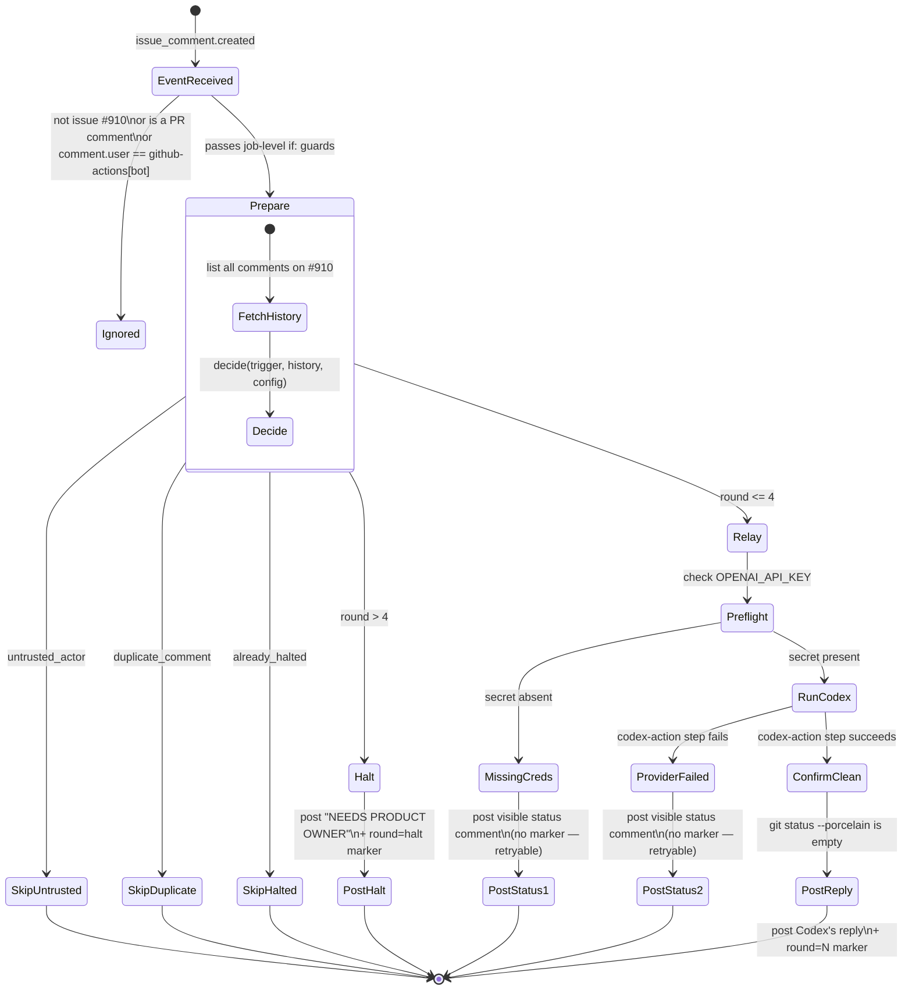

# Issue Discussion Relay — pilot (ME2-OPS03)

Event-driven relay that lets Codex join the discussion on **Issue #910 only**,
triggered by a Claude comment (or an explicit repository-owner request), in
place of a human copying messages between two chat windows. It replaces
nothing about how #910's governance conversation works — it only adds one
more, automated participant, bounded to 4 reply rounds per source comment.

This is a **pilot**, scoped to a single Issue. See "Non-goals" below for what
it deliberately does not do yet.

## What it is not

- Not a queue, not an orchestrator, not a scheduler. There is no database, no
  cron, no polling. The only state is the Issue's own comment history.
- Not `tools/ai-orchestrator` (a separate, inactive scaffold for a GPT
  reviewer ↔ Claude implementer *code* loop — see
  [`docs/specs/2026-08-07-ai-orchestrator-v0.1.md`](../../docs/specs/2026-08-07-ai-orchestrator-v0.1.md)).
  This tool never touches that module, its workflows, or its tests.
- Not a code-change mechanism. Codex's reply is posted as comment text. It
  has no tool that can edit a file, commit, push, merge, deploy, run a
  migration, or call a production system — and the job's own `contents: read`
  permission and post-run `git status --porcelain` check both fail closed if
  anything on the runner's filesystem changed anyway.

## Trigger

```
on:
  issue_comment:
    types: [created]
```

Nothing else fires this workflow — no `schedule`, no `pull_request`, no
`workflow_dispatch`. Editing an existing comment (`issue_comment.edited`)
does not trigger it either: only a brand-new comment counts.

## Guards, in the order they're evaluated

1. **Target issue** — `github.event.issue.number == 910`, hardcoded both in
   the workflow's job `if:` and again in `src/config.ts`
   (`TARGET_ISSUE_NUMBER`). Any other issue: the job's `if:` skips the run
   entirely, so it doesn't even check out the repository.
2. **Not a pull request** — `github.event.issue.pull_request == null`.
   GitHub fires `issue_comment` for PR comments too; this pilot ignores all
   of them, including PR #906.
3. **Not the workflow's own comment** — `github.event.comment.user.login !=
   'github-actions[bot]'` at the job `if:` level, and the identical check
   again inside `decide()` as defense in depth (`config.workflowBotLogin`).
4. **Trusted actor** (`decide()` in `src/decide.ts`) — one of:
   - the comment's author is a Bot whose login is in
     `config.trustedBotLogins` (default: `claude[bot]` — see "Open
     verification items" below), **or**
   - the comment's `author_association` is `OWNER` **and** the body contains
     the literal phrase `/relay-codex`.

   Anything else (a random commenter, a collaborator without the phrase, an
   unrecognized bot) is skipped with reason `untrusted_actor`.

## Identities

| Actor | How it's recognized | Why |
|---|---|---|
| Claude (posting the governance discussion) | `user.type == 'Bot'` and `user.login` in `trustedBotLogins` | Claude's own comment *is* the signal — no extra phrase required, matching the "replace the polling delay" goal. |
| Repository owner (`bigbigraydeng-maker`) | `author_association == 'OWNER'` and body contains `/relay-codex` | A human can always pull Codex into the thread explicitly, but a stray owner comment that isn't asking for a relay must not trigger one. |
| The relay's own replies | `github.event.comment.user.login == 'github-actions[bot]'` (default `GITHUB_TOKEN` identity) | Never respond to itself — checked at both the job `if:` and inside `decide()`. |
| Codex | Never given write access. Its output is comment text posted *by* the `github-actions[bot]` identity above, not its own GitHub identity. | Keeps the "who can trigger a round" trust boundary to exactly two identities. |

## Dedup and the round cap

There is no database — the Issue's comment history **is** the state, read
fresh on every run via `GitHubClient.listIssueComments` (`src/github-client.ts`,
paginated, and it throws rather than silently returning a truncated page —
a truncated read could miss a halt marker and relay past the cap).

Every reply this tool posts carries an invisible trailer
(`src/marker.ts`):

```
<!-- me2-issue-relay:v1 round=<N|halt> source_comment_id=<id> -->
```

`decide()` (`src/decide.ts`) scans that history and is pure — given the same
trigger comment and history, it always returns the same answer, which is
what makes it something `tests/decide.test.ts` can check exhaustively rather
than only by hand:

- **Dedup by comment id** — if any existing marker already names the
  trigger's comment id as its `source_comment_id`, skip
  (`duplicate_comment`). This mainly protects against a workflow re-run of
  an event that already produced a reply.
- **Round number** — the next round is `(highest round marker seen so far) +
  1`. Rounds count Codex replies, not "Claude + Codex" pairs.
- **Round cap** — if the next round would be `5` (i.e. round 4's reply
  already exists), post a single `NEEDS PRODUCT OWNER` comment instead
  (`src/cli.ts` → `cmdPostHalt`), carrying `round=halt`, and stop.
- **Once halted, stays halted** — any future trusted comment sees the halt
  marker and is skipped (`already_halted`) rather than opening a new round or
  posting a second halt notice. This pilot has no automatic reset; getting a
  6th message onto the thread after a halt is a deliberate, separate,
  human-initiated action (outside this tool's scope), not something this
  workflow does on its own.

## State diagram



## Failure recovery

Every failure path (missing `OPENAI_API_KEY`, a failing `openai/codex-action`
step) posts a **visible** status comment and, crucially, **posts no marker**.
Because the only state is markers in the comment history, "no marker posted"
is what "retryable" means here: re-running the same workflow run, or letting
the next trusted comment land, recomputes the identical decision. Nothing
needs to be reset by hand.

## Cost boundary

- Hard-capped at 4 Codex rounds per source comment, then a human-visible
  stop (`NEEDS PRODUCT OWNER`) with no further automatic spend.
- `concurrency: { group: me2-issue-relay-issue-910, cancel-in-progress:
  false }` serializes every run for this pilot, so two comments landing
  close together can't both spend on the same round.
- `permissions: { contents: read, issues: write }` only — no
  `pull-requests`, no `id-token`, no `actions`, no `deployments`. Even a
  compromised or misbehaving Codex step has no credential capable of a
  write outside "post one Issue comment".
- The job never runs `git commit` / `git push`, and a final step asserts
  `git status --porcelain` is empty after the Codex step, so a sandboxed
  Codex run that tried to write files would fail the job rather than
  silently succeed.

## Prompt safety

`src/prompt.ts` wraps the untrusted comment body between two explicit
delimiters and instructs the model to treat everything inside as data, never
as instructions — see `tests/prompt.test.ts`, including a test that an
attacker-controlled comment cannot forge its own closing delimiter to escape
the fence. The workflow never interpolates comment text into a shell `run:`
script (the classic GitHub Actions script-injection vector); it's read from
`GITHUB_EVENT_PATH` inside Node and written straight to a prompt file.

## Layout

```
src/config.ts          target issue, round cap, relay phrase, trusted identities
src/marker.ts           build/parse the invisible round marker
src/decide.ts            pure decision function — the thing tests/decide.test.ts covers exhaustively
src/prompt.ts            untrusted-data-safe prompt for Codex
src/github-client.ts     minimal REST client (list comments, paginated; post one comment)
src/cli.ts               workflow entrypoint — prepare / post-relay / post-halt / post-missing-credentials / post-provider-failure
tests/                   one file per module above
```

No new dependency: this uses only the repository's existing `typescript` and
`vitest`, plus Node's built-in `fetch`.

## Run it

```bash
npx tsc -p tools/issue-relay/tsconfig.json          # type check
npx vitest run tools/issue-relay --reporter=verbose  # unit tests, no network
npx tsc -p tools/issue-relay/tsconfig.build.json     # build to dist/ (what the workflow runs)
```

## Non-goals (out of scope for this pilot)

- Does not modify PR #906 or its scope.
- Does not generalize to any issue other than #910.
- Does not change `CLAUDE.md`, `CODEX.md`, Issue #910's governance text,
  branch protection, or repository permissions.
- Does not create a permanent queue or orchestrator.

## Open verification items (blockers before a live smoke test)

This pilot was implemented without live GitHub API / web access from the
authoring session, so two things are best-effort and need confirming before
`with: openai_api_key: ...` is ever exercised for real, per the deliverable's
requirement to report the Draft PR and preflight result first rather than
enable a live run:

1. **Claude's actual comment identity on this repository.** `src/config.ts`
   defaults `trustedBotLogins` to `['claude[bot]']`. Confirm this against a
   real `user.login` value from a Claude-authored comment on Issue #910 (or
   any issue) before relying on it, and correct the config (not the guard
   logic) if it's wrong.
2. **`openai/codex-action@v1`'s exact `with:` inputs and output field.** The
   workflow's `Run Codex` step inputs (`openai_api_key`, `prompt_file`,
   `sandbox: read-only`) and the `CODEX_REPLY_FILE` env var populated from
   its output are a best-effort mapping based on how the action is described
   in this issue, not a verified reading of the action's published
   `action.yml`. Confirm against the action's actual documentation before
   enabling a live run.
